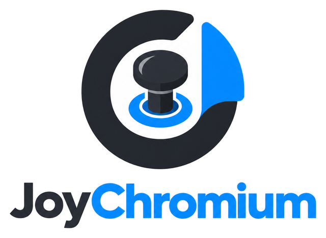

  <picture>
    <source media="(prefers-color-scheme: dark)" srcset="docs/assets/logo-dark.png">
    
  </picture>

# JoyChromium

A web browser for the TV that you drive with a **game controller** from the couch. It opens full screen, walks pages with the D-pad, points and clicks with the stick, types with an Xbox-style on-screen keyboard and blocks ads out of the box.

English · [Português (Brasil)](README.pt-BR.md)

## Download

### Windows 10/11

Download **[JoyChromium 0.1.5](https://github.com/lippdev/joychromium/releases/tag/v0.1.5)**, the first stable Windows release.

- **`JoyChromium-0.1.5-win-x64.exe`** for Intel and AMD PCs.
- **`JoyChromium-0.1.5-win-arm64.exe`** for Windows on ARM PCs.

Per-user install, no admin. Windows 10 or 11 and a controller: Xbox, PlayStation (DualShock / DualSense), Switch Pro, 8BitDo or any pad Windows sees as a gamepad.

JoyChromium checks for stable updates on launch and installs them silently. If you use 0.1.4-beta or earlier, install this release manually once. Playback on Netflix and other paid streaming services still needs validation.

### Linux (CachyOS)

The x64 AppImage alpha is available for testing through [GitHub Actions](https://github.com/lippdev/joychromium/actions/workflows/ci.yml). CachyOS validation is in progress. Updates are manual.

## How it works

1. Install, plug in your controller and open JoyChromium. It starts full screen on the TV.
2. Pick your language and search engine with the D-pad and A.
3. Browse: the D-pad jumps from link to link, the left stick moves a pointer for everything else, and A clicks.

| Controller | Does | With the keyboard open |
|---|---|---|
| **Left stick** | Moves the pointer | Walks the keys |
| **Right stick** | Scrolls the page (sideways too) | — |
| **D-pad** | Jumps between links and buttons; up from the top reaches the toolbar and tabs | Walks the keys and suggestions |
| **A** | Clicks (twice quickly at the pointer: right click) | Types the key |
| **B** | Back, or closes a menu | Closes the keyboard |
| **X** | Reloads | Backspace |
| **Y** | Opens the keyboard on the address bar (**LB + Y**: favorite) | Space |
| **LB / RB** | Back / forward | — |
| **LT / RT** | Previous / next tab | **LT**: Shift |
| **Start** | Quick menu | Go |
| **Back / View** | Closes the tab (on the last tab, opens a new one; never quits) | — |
| **Right stick click** | Switches the D-pad mode: *Spatial → Cursor → Arrows* (remembered per site) | — |
| **Left stick click** | — | Letters → symbols → accents |

On a PlayStation pad the letters become ✕ ○ □ △; the keyboard's button glyphs follow the pad you last touched. A keyboard and mouse work too: `F11` switches between TV mode and a window, `Ctrl+T` opens a tab, `Ctrl+Shift+N` a private one, `Ctrl+W` closes it.

## Features

- **Three ways to move:** *Spatial* (the D-pad picks the nearest link in that direction), a smooth **pointer** on the left stick that turns into a hand over anything clickable, and *Arrows* for sites with their own TV interface, like YouTube TV
- **Xbox-style on-screen keyboard** with the shortcuts on the controller's own buttons, address suggestions and Portuguese accents
- **TV-first interface:** full screen, large text and a clear focus ring you can see from the couch, with overscan and size options for older TVs
- **Ad and tracker blocking** built in (Ghostery engine with EasyList, EasyPrivacy and uBlock lists), turned on or off from the shield on the toolbar
- Tabs with previews, private tabs, history, favorites and site icons
- Opens from launchers: `--tv` / `--window` / `--new-tab` flags and `joychromium://` links, so [Console Mode](https://github.com/lippdev/consolemode), Playnite or Steam can start it ([integrations](docs/INTEGRATIONS.md))
- English and Portuguese

## Roadmap

**Now:** Windows 10/11 · **Next:** macOS ([#108](https://github.com/lippdev/joychromium/issues/108)), Linux, Wayland and Flathub ([#109](https://github.com/lippdev/joychromium/issues/109)), Steam Deck ([#110](https://github.com/lippdev/joychromium/issues/110)) · [All platforms](docs/ROADMAP.md)

## More

- [Install and troubleshooting](docs/INSTALL.md) · [Current status](docs/STATUS.md) · [Release process](docs/RELEASE.md) · [Controller test script](docs/CONTROLLER-TEST.md)
- **Feedback and bugs:** [open an issue](https://github.com/lippdev/joychromium/issues/new). A ⭐ helps other couch browsers find the project.
- **Build from source:** Node.js 24, then `cd app && npm ci && npm start`. Tests: `npm run typecheck`, `npm test`, `npm run test:e2e`. See [CONTRIBUTING.md](CONTRIBUTING.md).
- The installer is not code-signed yet, so Windows SmartScreen may say *"Windows protected your PC"*: click **More info → Run anyway**. The source is all here.

[MIT License](LICENSE)
