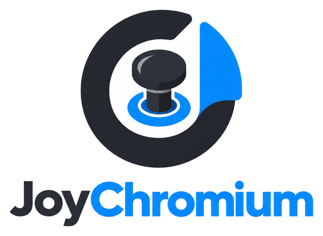

<p align="center">
  <picture>
    <source media="(prefers-color-scheme: dark)" srcset="docs/assets/logo-dark.png">
    
  </picture>
</p>

# JoyChromium

A controller-first browser for the TV, built on Electron (Chromium). Windows, macOS and Linux from one code base. Every page announces itself as a TV (`JoyChromiumTV/1.0 (TV; SmartTV)`), ads and trackers are blocked out of the box, and a gamepad is the primary way to browse: the app opens fullscreen in TV mode.

## Platforms

| | Windows | macOS | Linux |
|---|---|---|---|
| Installers | `.exe` (NSIS, x64 + arm64) | `.dmg` / `.zip` (x64 + arm64) | `.AppImage`, `.deb`, `.rpm` (x64 + arm64); Flatpak bundle from CI (not on Flathub yet) |
| Updates itself | yes | no, it points you to the release page (see below) | AppImage yes; `.deb`/`.rpm` ask for your password; inside the Flatpak, the host updates it |
| Code signing | none yet | ad-hoc only | none |
| Native window controls | drawn by the app | macOS traffic lights | drawn by the app |
| DRM (Netflix, Prime Video) | Widevine from the castLabs build | same | same, without VMP |
| Shortcuts | `Ctrl+…` | `Cmd+…` | `Ctrl+…` |

The first launch downloads the Widevine module in the background; playback of DRM services works from the next launch, and the version shows up in Settings → About. Windows and macOS builds still need the castLabs EVS signature (VMP) before paid streaming works reliably there; the Linux module does not use VMP.

Nothing here costs money ([PRD](docs/PRD.md), ADR-010): no code-signing certificate, no paid service, and the whole pipeline runs on a public repository. The app works, but because the builds are unsigned the operating system warns the first time:

- **macOS**: the `.dmg` refuses its one-click install on macOS 15 with *"This Mac could not verify the app, so nothing was installed"* — the bundle's ad-hoc signature is intact (`codesign --verify --deep --strict` passes), what would fix it is a Developer ID and notarization, which this project deliberately does not buy. Drag JoyChromium to Applications (or double-click `install-macos.command` inside the disk image) and open it once with right-click → *Open*; if that option is not offered, run `xattr -dr com.apple.quarantine /Applications/JoyChromium.app`. After that it opens normally. Apple Silicon refuses a completely unsigned app, so every build gets the ad-hoc signature; that is enough to launch, but not enough for automatic updates.
- **Windows**: SmartScreen shows *Windows protected your PC*; choose *More info → Run anyway*. The warning fades as the build gains reputation.
- **Linux**: AppImage needs `chmod +x JoyChromium-*.AppImage`; if your distribution blocks the sandbox (Ubuntu 24.04 restricts user namespaces), install the `.deb` or the Flatpak bundle instead.

Step-by-step instructions, including recovery when the system refuses to open the app, are in [docs/INSTALL.md](docs/INSTALL.md).

The current state of the app — what is proven, what is not, and who owes what — is in [docs/STATUS.md](docs/STATUS.md). More documentation: [docs/RELEASE.md](docs/RELEASE.md) (how a release is cut and what each installer does), [docs/POLICY.md](docs/POLICY.md) (the signing key and the remote policy), [docs/CONTROLLER-TEST.md](docs/CONTROLLER-TEST.md) (the on-a-real-TV checklist), [docs/SCREEN-READER.md](docs/SCREEN-READER.md) (the screen-reader pass), [docs/WAYLAND.md](docs/WAYLAND.md) (native Wayland and the Steam Deck recipe) and [docs/PRD.md](docs/PRD.md) (architecture and backlog).

## Run from source

Requirements: Node.js 24+.

```bash
cd app
npm ci
npm start
```

`npm start` bundles the app with esbuild and launches Electron. Useful environment variables: `JOYCHROMIUM_DATA` (data folder, defaults to the OS user-data dir) and `JOYCHROMIUM_START` (first URL, skips onboarding).

## Controller

Standard gamepads (Xbox, PlayStation, Switch Pro and anything the Gamepad API maps) work on every platform.

| Input | Action |
|---|---|
| D-pad / left stick | move (see *input modes*) |
| A | select / activate |
| B | back, or close the keyboard / prompt |
| X | reload |
| Y | controller keyboard (hold LB: toggle favorite) |
| LB / RB | history back / forward |
| LT / RT | previous / next tab |
| Start | new tab |
| Back / View | close tab |
| Right stick click | cycle input mode |

Keyboard: `Ctrl+L` address (`Cmd+L` on macOS), `Ctrl+T` new tab, `Ctrl+Shift+T` reopen closed, `Ctrl+Shift+N` private tab, `Ctrl+W` close, `Ctrl+Tab` switch, `Ctrl+D` favorite, `Ctrl+F` find, `Ctrl+H` history, `Ctrl+B` favorites, `Ctrl+M` mute, `Ctrl` `+`/`-`/`0` zoom, `F11` switches between TV mode (fullscreen) and window mode, `Ctrl+,` settings. On macOS every one of these uses `Cmd` instead of `Ctrl`.

### Input modes

Each site runs in one of three modes, remembered per host (Settings → Controller). **Spatial** (default): the D-pad jumps between links, buttons and fields using `spatial.js` (nearest element in that direction; scrolls when nothing is ahead). **Cursor**: the left stick moves a pointer, D-pad nudges, A clicks, right stick scrolls. **Arrows** (default for youtube.com and twitch.tv): D-pad and A are sent as arrow keys and Enter, for sites with their own 10-foot UI.

## Security defaults

Ad and tracker blocking (Ghostery engine with the EasyList/EasyPrivacy/uBlock lists, refreshed daily), HTTPS-only with a per-host fallback prompt, certificate errors always blocked, only `http(s)` and `joychromium://` addresses navigate, camera/microphone/location prompt every time unless remembered, downloads go to `Downloads/JoyChromium` with risky extensions refused (including `.dmg`, `.pkg`, `.app` on macOS and `.desktop`, `.flatpakref`, `.snap` on Linux), popups rate-limited, private tabs, password saving and autofill off (the app never stores credentials). Optional DNS-over-HTTPS (Cloudflare/Quad9/Google) and three levels of tracking prevention that change the block lists themselves (Basic blocks ads, Balanced adds the tracker lists EasyPrivacy and uBlock privacy, Strict adds the social-widget list; Balanced and Strict also ask sites not to track and send Global Privacy Control, and Strict blocks third-party cookies). Everything is in Settings → Privacy & security.

## Staying up to date without waiting for a release

- **Engine**: the app runs on the castLabs Electron for Content Security build, which brings Chromium plus the Widevine module that streaming services need. It is not on npm, so `.github/workflows/engine-update.yml` looks for a new release every day and opens a bump PR; CI (Windows, macOS and Linux: typecheck, unit tests, an end-to-end run of the real app, and a packaging build) gates it; a green run merges automatically and `release.yml` publishes a new version. Installed apps update themselves, except on macOS.
- **Block lists**: the engine re-downloads the lists every 24 hours from the official CDN.
- **Policy**: `policy/policy.json` (signed with `app/scripts/policy-sign.mjs`; public key embedded in `src/shared/policy.ts`) can raise the minimum Chromium, block hosts, add risky download extensions, mark broken app versions so the updater skips them, and show a message. It is fetched from `main`, verified, cached and can only tighten the defaults.

## Development

```bash
cd app
npm run typecheck
npm test          # vitest: the pure modules in src/shared and src/main
npm run test:e2e  # Playwright launches the real app with a throwaway profile
npm run dist      # local installer in app/release (no publish; rpm needs rpmbuild)
```

Layout: `src/shared` (pure rules, tests next to them), `src/main` (Electron main process and its services), `src/preload` (bundled bridges), `src/renderer/shell` (Preact UI), `src/assets` (internal pages and the design tokens). See `CONTRIBUTING.md` for the branch and commit conventions and `docs/PRD.md` for the architecture, platform matrix, redesign and backlog (`docs/history/CHECKLIST-webview2.md` is the historical WebView2-era checklist).

## History

The first prototype was a WPF + WebView2 app (see the git history before the Electron migration). It was replaced because the WebView2 engine is Windows-only and the maintained C# bridges to a bundled Chromium lag years behind upstream; Electron keeps the engine current on every platform.
