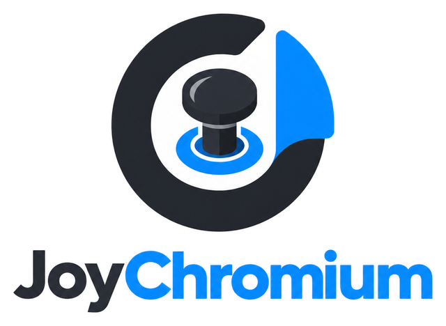

  <picture>
    <source media="(prefers-color-scheme: dark)" srcset="docs/assets/logo-dark.png">
    
  </picture>

# JoyChromium

Um navegador para a TV que você usa com o **controle de videogame**, do sofá. Abre em tela cheia, anda pelas páginas com o D-pad, aponta e clica com o analógico, digita com um teclado na tela no estilo do Xbox e já vem bloqueando anúncios.

[English](README.md) · Português (Brasil)

## Baixar

### Windows 10/11

Baixe o **[JoyChromium 0.1.5](https://github.com/lippdev/joychromium/releases/tag/v0.1.5)**, a primeira versão estável para Windows.

- **`JoyChromium-0.1.5-win-x64.exe`** para PCs Intel e AMD.
- **`JoyChromium-0.1.5-win-arm64.exe`** para PCs com Windows em ARM.

Instala só para o seu usuário, sem administrador. Requer Windows 10 ou 11 e um controle: Xbox, PlayStation (DualShock / DualSense), Switch Pro, 8BitDo ou qualquer um que o Windows reconheça como gamepad.

O JoyChromium verifica atualizações estáveis ao abrir e instala em silêncio. Se você usa a 0.1.4-beta ou anterior, instale esta versão manualmente uma vez. A reprodução na Netflix e em outros serviços de streaming pagos ainda precisa de validação.

### Linux (CachyOS)

O AppImage alfa x64 está disponível para testes pelo [GitHub Actions](https://github.com/lippdev/joychromium/actions/workflows/ci.yml). A validação no CachyOS está em andamento. As atualizações são manuais.

## Como funciona

1. Instale, conecte o controle e abra o JoyChromium. Ele abre em tela cheia na TV.
2. Escolha o idioma e o buscador com o D-pad e o A.
3. Navegue: o D-pad pula de link em link, o analógico esquerdo move um ponteiro para todo o resto e o A clica.

| Controle | Faz | Com o teclado aberto |
|---|---|---|
| **Analógico esquerdo** | Move o ponteiro | Anda pelas teclas |
| **Analógico direito** | Rola a página (para os lados também) | — |
| **D-pad** | Pula entre links e botões; para cima, do topo, chega à barra e às abas | Anda pelas teclas e sugestões |
| **A** | Clica (duas vezes rápido no ponteiro: clique direito) | Digita a tecla |
| **B** | Volta, ou fecha um menu | Fecha o teclado |
| **X** | Recarrega | Apaga |
| **Y** | Abre o teclado na barra de endereço (**LB + Y**: favoritar) | Espaço |
| **LB / RB** | Voltar / avançar | — |
| **LT / RT** | Aba anterior / próxima | **LT**: Shift |
| **Start** | Menu rápido | Enviar |
| **Back / View** | Fecha a aba (na última, abre uma nova; nunca fecha o navegador) | — |
| **Clique do analógico direito** | Troca o modo do D-pad: *Espacial → Cursor → Setas* (lembrado por site) | — |
| **Clique do analógico esquerdo** | — | Letras → símbolos → acentos |

No controle de PlayStation as letras viram ✕ ○ □ △; os símbolos do teclado seguem o último controle que você tocou. Teclado e mouse também funcionam: `F11` alterna entre o modo TV e janela, `Ctrl+T` abre uma aba, `Ctrl+Shift+N` uma aba anônima, `Ctrl+W` fecha.

## Recursos

- **Três jeitos de andar:** *Espacial* (o D-pad escolhe o link mais próximo naquela direção), um **ponteiro** suave no analógico esquerdo que vira mãozinha sobre o que é clicável, e *Setas* para sites com interface própria de TV, como o YouTube TV
- **Teclado na tela no estilo do Xbox**, com os atalhos nos próprios botões do controle, sugestões de endereço e acentos do português
- **Interface feita para a TV:** tela cheia, letras grandes e um foco bem visível do sofá, com ajuste de overscan e de tamanho para TVs mais antigas
- **Bloqueio de anúncios e rastreadores** embutido (motor Ghostery com as listas EasyList, EasyPrivacy e uBlock), ligado ou desligado pelo escudo na barra
- Abas com miniaturas, abas anônimas, histórico, favoritos e ícones dos sites
- Abre a partir de launchers: flags `--tv` / `--window` / `--new-tab` e links `joychromium://`, para o [Console Mode](https://github.com/lippdev/consolemode), o Playnite ou a Steam abrirem o app ([integrações](docs/INTEGRATIONS.md))
- Português e inglês

## Roadmap

**Agora:** Windows 10/11 · **Depois:** macOS ([#108](https://github.com/lippdev/joychromium/issues/108)), Linux, Wayland e Flathub ([#109](https://github.com/lippdev/joychromium/issues/109)), Steam Deck ([#110](https://github.com/lippdev/joychromium/issues/110)) · [Todas as plataformas](docs/ROADMAP.md)

## Mais

- [Instalação e problemas comuns](docs/INSTALL.md) · [Estado atual](docs/STATUS.md) · [Processo de release](docs/RELEASE.md) · [Roteiro de teste com controle](docs/CONTROLLER-TEST.md)
- **Sugestões e bugs:** [abra uma issue](https://github.com/lippdev/joychromium/issues/new). Uma ⭐ ajuda outras pessoas a acharem o projeto.
- **Rodar do código:** Node.js 24, depois `cd app && npm ci && npm start`. Testes: `npm run typecheck`, `npm test`, `npm run test:e2e`. Veja o [CONTRIBUTING.md](CONTRIBUTING.md).
- O instalador ainda não tem assinatura de código, então o SmartScreen pode dizer *"O Windows protegeu o computador"*: clique em **Mais informações → Executar assim mesmo**. Todo o código está aqui.

[Licença MIT](LICENSE)
