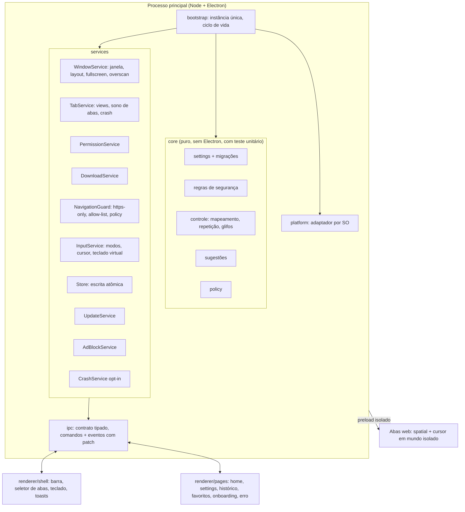
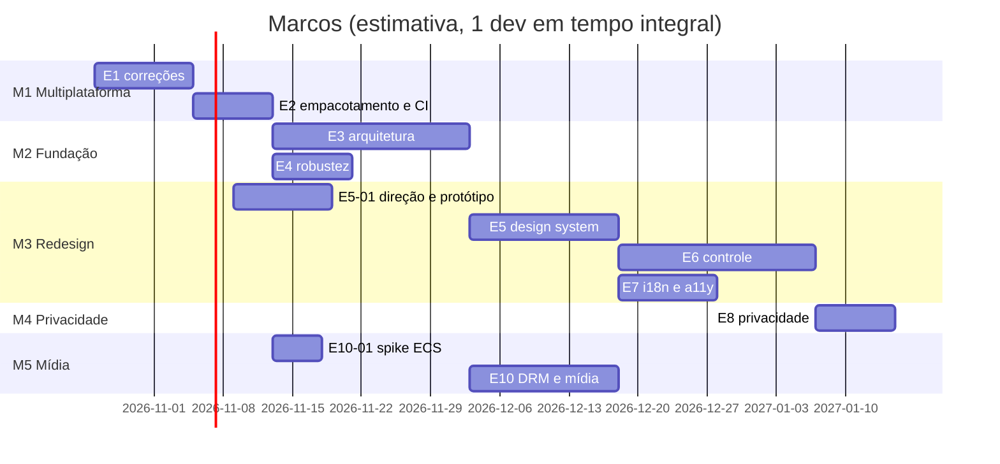

# JoyChromium — PRD 2.0: arquitetura, multiplataforma e redesign

> Documento vivo. Substitui o `docs/CHECKLIST.md` como fonte de verdade do que falta fazer.
> Estado de referência: `main` em a1de202 (Electron 44.8.0 / Chromium 152), outubro de 2026.

## 1. Resumo

O JoyChromium já roda em Electron com um único código para Windows e Linux. O CI verde nas duas plataformas prova isso: typecheck, 20 testes unitários, 3 e2e com o app real e um build de instalador. O que falta para ser um produto multiplataforma de verdade, e um navegador de TV bom de usar, cai em quatro frentes:

1. **Multiplataforma completo.** O macOS não existe (sem target, sem CI, sem assinatura). Também há bugs de borda no Linux e no mac (botões da janela invisíveis, copiar/colar, atalhos e caminhos).
2. **Arquitetura.** O `shell.ts` concentra quase tudo. A UI é HTML/TS sem bundler e sem componentes, os tokens de design estão duplicados em cada página, a persistência não é atômica e há configurações que não fazem nada desde a saída do WebView2.
3. **Redesign 10-foot.** A interface atual é um navegador de desktop com fontes de 10 a 13 px, ícones em caracteres Unicode e emoji, e fontes do Windows. Para TV, a 3 metros de distância, ela precisa de outra escala, outra hierarquia e navegação por foco desenhada para o controle.
4. **Distribuição e mídia.** Faltam arm64, mais formatos de Linux e Widevine (DRM) para os serviços de streaming. O app segue sem assinatura de código por enquanto (seção 13).

O Electron continua sendo a base. A seção 5.1 explica por quê.

## 2. Objetivos e não-objetivos

### Objetivos
- **O1.** Mesma experiência em Windows 10/11, macOS (Apple Silicon e Intel) e Linux (X11 e Wayland; Ubuntu/Debian, Fedora, Arch e SteamOS), em x64 e arm64.
- **O2.** Uso completo só com controle, do primeiro boot até assistir a um vídeo, sem teclado nem mouse.
- **O3.** Interface legível a 3 m numa TV 1080p e 4K, com área segura de overscan.
- **O4.** Atualização automática no Windows e no Linux; no macOS, aviso de nova versão com download manual enquanto o app não for assinado.
- **O6.** Streaming com DRM (Netflix, Prime Video, Disney+) funcionando via castLabs ECS.
- **O5.** Uma arquitetura em que cada responsabilidade tem um módulo, com contrato de IPC tipado e lógica pura testável sem Electron.

### Não-objetivos (nesta versão)
- Extensões de navegador (Chrome Web Store).
- Sincronização de conta entre dispositivos.
- Builds para Android TV, tvOS ou webOS. Eles exigiriam outro motor e outro produto.
- Motor próprio ou fork do Chromium.

## 3. Personas e cenários

| Persona | Contexto | O que precisa |
|---|---|---|
| **Sofá** (persona principal) | PC ou mini-PC ligado na TV, controle Xbox/PS/8BitDo, app em tela cheia | Abrir YouTube TV, Twitch e streaming em 3 cliques, digitar pouco, nunca precisar do mouse |
| **HTPC / Steam Deck** | Linux (SteamOS, Ubuntu), muitas vezes Wayland ou modo Gaming | Tela cheia de verdade, controle sem configuração, atualização sem terminal |
| **Mac na TV** | Mac mini ligado à TV por HDMI | Controle funcionando, atalhos Cmd, instruções claras para abrir um app não assinado |
| **Desktop eventual** (secundária) | Mesma máquina usada na mesa | Modo Janela com mouse e teclado continua funcional, sem ser o foco do produto |

Cenários de aceite de ponta a ponta (servem de roteiro para os testes manuais com controle):

1. Primeiro boot já em tela cheia → onboarding com teste do controle → escolher idioma e buscador → tela inicial.
2. Tela inicial → YouTube TV (modo Arrows) → vídeo em tela cheia → voltar com B.
3. Pesquisar "previsão do tempo" com o teclado virtual e as sugestões, abrir o resultado e navegar no modo Spatial.
4. Abrir três abas, alternar pelo seletor de abas e fechar uma, só com controle.
5. Um site pede o microfone → prompt navegável → "permitir sempre".
6. Windows/Linux: atualização baixada em segundo plano → aplicada ao fechar → o app reabre na versão nova. macOS: o app avisa que há versão nova e abre a página da release.
7. Abrir a Netflix, entrar na conta e assistir a um título com DRM.

## 4. Diagnóstico do estado atual

### 4.1 O que já está bom
- Electron 44 com sandbox, `contextIsolation` e preloads isolados. As páginas web não recebem nenhuma API.
- Segurança de navegação: lista de esquemas permitidos, HTTPS-only com fallback por host, erro de certificado sem bypass, popups limitados, permissões negadas por padrão com memória por site, downloads perigosos recusados.
- Bloqueio de anúncios com o motor Ghostery, cacheado em disco e atualizado a cada 24 h.
- Policy remota assinada (ECDSA P-256) que só aperta as regras.
- Pipeline Dependabot → CI → auto-merge → tag → release → `electron-updater`.
- Três modos de entrada (Spatial, Cursor, Arrows) lembrados por host.

### 4.2 Problemas encontrados

| # | Área | Problema | Evidência | Impacto |
|---|---|---|---|---|
| D1 | Plataforma | Botões minimizar/maximizar/fechar usam glifos da fonte `Segoe MDL2 Assets`, que só existe no Windows | `app/src/assets/chrome/chrome.css:33`; no Linux os botões aparecem vazios | Sem como fechar ou minimizar a janela pelo mouse no Linux e no mac |
| D2 | Plataforma | `Menu.setApplicationMenu(null)` remove o menu de edição | `app/src/main/main.ts:40` | No macOS, Cmd+C/V/X/A e Cmd+Q deixam de funcionar |
| D3 | Plataforma | Atalhos do renderer testam só `ctrlKey`, e os textos de ajuda dizem "Ctrl+" | `app/src/renderer/chrome.ts:235`, títulos no HTML | Atalhos errados no mac |
| D4 | Plataforma | Pasta de downloads montada com `homedir()/Downloads` | `app/src/main/shell.ts` (`handleDownload`) | Ignora pastas XDG localizadas no Linux e diverge do export de diagnóstico, que usa `app.getPath("downloads")` |
| D5 | Plataforma | Extensões perigosas sem as do macOS (`.dmg`, `.pkg`, `.app`, `.command`...) | `app/src/shared/security.ts:6` | Instaladores de mac passam |
| D6 | Plataforma | macOS sem target, ícone em alta resolução (o `icon.png` tem 256 px), CI, entitlements ou assinatura | `app/package.json` (`build`) | Não existe build para mac |
| D7 | Plataforma | Só x64 | `app/package.json` | Sem Apple Silicon nativo, sem Raspberry Pi/TV boxes ARM, sem Windows on ARM |
| D8 | Robustez | Sem trava de instância única | `app/src/main/main.ts` | Duas instâncias sobrescrevem `settings.json`, `session.json` e histórico |
| D9 | Robustez | Escritas síncronas de arquivo inteiro, sem gravar em temporário e renomear | `app/src/main/store.ts`, `history.ts` | Queda de energia no meio da escrita corrompe as configurações |
| D10 | Robustez | "Abas dormindo após 10 min" está marcada como feita no checklist, mas não existe no Electron (`lastActive` é gravado e nunca lido) | `app/src/main/tabs.ts` | Memória cresce sem limite em mini-PCs de TV |
| D11 | Produto | Configurações sem efeito: `trackingPrevention`, `passwordAutosave` e `autofill` são salvas, mas nada no main as aplica | `app/src/main/pageBridge.ts:111-112` | O usuário acha que está protegido e não está |
| D12 | Produto | A página de settings ainda fala em "WebView2, atualizado pelo Windows" | `app/src/assets/settings.html:156,198` | Texto falso em Linux e mac |
| D13 | Arquitetura | `shell.ts` (576 linhas) cuida de janela, layout, permissões, downloads, teclado virtual, busca, modos de entrada, atalhos e IPC | `app/src/main/shell.ts` | Difícil de testar e de mexer em paralelo |
| D14 | Arquitetura | Canais de IPC duplicados nos preloads, porque preload sandboxed não importa módulos; o canal `shell:layout` nem está em `ipc.ts` | `app/src/preload/*.ts`, `app/src/main/shell.ts` | Contrato de IPC pode divergir em silêncio |
| D15 | Arquitetura | O estado inteiro é reenviado ao renderer a cada mudança | `Shell.broadcast()` | Custo cresce com o número de abas e repinta a UI toda |
| D16 | Arquitetura | `spatial.js` é injetado com `executeJavaScript` no mundo da página e só no frame principal | `app/src/main/tabs.ts` (`dom-ready`) | A página enxerga e pode quebrar `window.__joy`; iframes (players embutidos) ficam sem navegação espacial |
| D17 | UI | Tokens de cor e fonte copiados em cada HTML; fonte `Segoe UI`; ícones em Unicode e emoji; fonte base de 10 a 13 px | `chrome.css`, `list.css`, `<style>` de cada página | Visual inconsistente entre SOs e ilegível na TV |
| D18 | UI | Strings em inglês fixas no HTML; sem i18n | todas as páginas | Sem PT-BR |
| D19 | Docs | `docs/CHECKLIST.md` descreve WebView2, Velopack, FlaUI e `%LocalAppData%`; o `CLAUDE.md` aponta a chave da policy em `%USERPROFILE%` | `docs/`, `CLAUDE.md` | Passa a impressão de projeto só para Windows |
| D20 | Mídia | Electron padrão não traz Widevine | — | Netflix, Prime Video e Disney+ (atalhos padrão da nova aba) não tocam |
| D21 | Update | Em `.deb`/`.rpm`, o `electron-updater` precisa de `installPendingUpdateIfAvailable()` explícito com prompt de senha (pkexec); o app só usa `autoInstallOnAppQuit` | `app/src/main/updater.ts`; documentação do electron-builder | Usuários de `.deb` podem ficar presos numa versão |

## 5. Arquitetura alvo

### 5.1 Decisão de base: continuar no Electron (ADR-001)

| Opção | Prós | Contras | Veredito |
|---|---|---|---|
| **Electron (atual)** | Chromium igual nos três SOs, atualizado por Dependabot; `WebContentsView`, `session` e `webRequest` para bloqueio; Gamepad API; ecossistema de empacotamento e update | Pacote de ~100 MB, uso de memória | **Manter** |
| Tauri | Binário pequeno | Usa o WebView do SO (WebKit no mac e Linux): perde o Chromium uniforme, o bloqueio por sessão e o comportamento igual do Gamepad API; o UA de TV muda por SO | Descartado |
| CEF (C++) / .NET + CefSharp | Controle total | Meses de trabalho; o CefSharp é só Windows, que é exatamente o problema de que saímos | Descartado |

### 5.2 Visão geral



### 5.3 Estrutura de pastas

```
app/
  scripts/           # build.mjs (esbuild), after-pack.mjs, copy-assets.mjs, policy-sign.mjs
  src/
    shared/          # puro, com teste unitário: settings, segurança, policy, páginas, controle, i18n, plataforma
    main/
      main.ts        # instância única, ciclo de vida, wiring
      platform.ts    # único módulo que lê process.platform
      shell.ts       # janela, layout das views, comandos, permissões, downloads
      tabs.ts        # uma WebContentsView por aba + hooks de segurança
      pageBridge.ts  # mensagens das páginas internas
      protocol.ts    # esquema joychromium://
      services/      # commandRouter, inputRouter, navigation, keyboard, layout, permissions, downloads,
                     # crashReporting, privacy, widevine
      adblock.ts, policyService.ts, updater.ts, history.ts, store.ts, atomicFile.ts, log.ts, diagnostics.ts,
      controllerActions.ts, tvIdentity.ts, zip.ts
    preload/         # chrome.ts e web.ts, empacotados: importam o contrato de src/shared
    renderer/shell/  # UI do navegador em Preact: app, tabswitcher, keyboard, quickmenu, toasts, gamepad
    assets/          # páginas internas em HTML, design tokens, i18n.js e spatial.js
  tests/unit, tests/e2e
  resources/         # ícones por SO, entitlements do mac
```

### 5.4 Decisões técnicas (ADRs em `docs/adr/`)

- **ADR-002: build com `esbuild` (decidido).** Um script (`app/scripts/build.mjs`) empacota o processo principal, os preloads e o shell, e copia as páginas internas para `dist/assets`; `tsc --noEmit` continua sendo o typecheck. O preload empacotado importa o contrato de IPC de `src/shared`, o que resolve o D14, e o renderer pode usar Preact. Não há servidor de desenvolvimento: `npm start` recompila em menos de um segundo. O `electron-vite` previsto no início do PRD ficou de fora porque assume um `index.html` por bundle, e o app serve vários HTMLs independentes por `joychromium://`.
- **ADR-003: framework de UI — Preact (decidido).** **Preact + TypeScript** no renderer, com `@preact/signals` para o estado vindo do main e uma navegação por foco própria derivada do `spatial` atual (bibliotecas de foco para React, como a Norigin, só entram via `preact/compat` se valerem a pena). O redesign cria muitas telas com componentes repetidos (cards, listas focáveis, diálogos, teclado), e HTML com script inline não escala; o Preact resolve isso com ~4 KB, o que pesa num shell que fica sempre aberto.
- **ADR-004: contrato de IPC tipado e validado (decidido).** `src/shared/ipc.ts` declara os canais e os tipos, `src/shared/commands.ts` valida cada comando na entrada do main (comando malformado é logado e descartado) e o preload empacotado importa o contrato em vez de repetir nomes. O estado sai como snapshot completo uma vez, no `shell:ready`, e depois por patches de área (`shell:patch`), que resolvem o D15 (E3-03).
- **ADR-005: persistência (decidido).** Continua em JSON (`settings.json`, `session.json`, `history.jsonl`), agora com escrita atômica (temporário mais `rename`), `schemaVersion` e migrações puras em `src/shared/settings`. SQLite fica fora porque exigiria módulo nativo recompilado por SO e por arquitetura.
- **ADR-006: injeção em mundo isolado (decidido).** `spatial` e cursor rodam em `executeJavaScriptInIsolatedWorld` (world 73) e o shell conversa com esse mundo por `runInPageWorld`, então a página não lê nem substitui `window.__joy` (D16). Desde o E3-06 o preload da aba leva o mesmo script a todo frame, então um player em iframe também é navegável e o D-pad atravessa a borda do frame.
- **ADR-007: adaptador de plataforma.** Toda decisão por SO passa por `platform/`: opções da janela, menu de aplicação, modificador de atalho e rótulo, caminhos, extensões perigosas extras, comportamento ao fechar a última janela e integração de mídia. O resto do código não testa `process.platform`.
- **ADR-008: modo TV como padrão (decidido).** O app abre em **tela cheia, no modo TV**, desenhado para o controle. O **modo Janela** (mouse e teclado) é secundário: entra-se nele por F11/Esc ou pelas configurações, e ele reaproveita os mesmos serviços e componentes com outra escala e densidade. Toda tela nova é desenhada e aceita primeiro no modo TV.
- **ADR-009: DRM com castLabs ECS (decidido).** O pacote `electron` é trocado pelo Electron for Content Security da castLabs, que instala a CDM Widevine no primeiro uso. A assinatura VMP do serviço EVS (gratuito, conta na castLabs) é necessária para Widevine de produção no Windows e no macOS; ela é independente da assinatura de código da Apple e da Microsoft, que continua fora do escopo. No Linux a CDM não usa VMP. O ECS é distribuído pelo GitHub da castLabs e não pelo registro do npm, então o Dependabot deixa de cobrir o motor e um workflow agendado assume essa função (E10-03).
- **ADR-010: sem assinatura de código por enquanto (decidido).** Os builds saem sem Developer ID e sem certificado Windows. Consequências aceitas: alerta do SmartScreen no Windows; no macOS, o Gatekeeper exige liberar o app em Ajustes do Sistema → Privacidade e Segurança → "Abrir Mesmo Assim", e o auto-update nativo (Squirrel.Mac) não funciona. Os builds de mac recebem assinatura ad-hoc (`identity: "-"`), sem a qual o Apple Silicon recusa o app como "danificado".

### 5.5 Matriz de plataforma

| Tema | Windows | macOS | Linux |
|---|---|---|---|
| Janela | sem moldura + controles próprios em SVG | `titleBarStyle: "hiddenInset"` com os botões nativos | sem moldura + controles em SVG; validar arrasto no Wayland |
| Menu de aplicação | nenhum | menu mínimo com papéis `appMenu` e `editMenu` | nenhum |
| Modificador | Ctrl | Cmd | Ctrl |
| Fechar última janela | sai | sai (decisão de produto: é um app de TV) | sai |
| Downloads | `app.getPath("downloads")` | idem | idem (respeita XDG) |
| Extensões perigosas extras | — | `.dmg .pkg .mpkg .app .command .scpt .workflow .terminal` | `.desktop .flatpakref .snap` |
| Formatos | NSIS (x64, arm64) | DMG + ZIP (universal ou x64 + arm64) | AppImage, deb, rpm (x64, arm64); bundle Flatpak (publicação no Flathub pendente de conta) |
| Auto-update | NSIS por usuário (automático) | aviso de nova versão + download manual (Squirrel.Mac exige assinatura) | AppImage automático; deb/rpm com prompt de senha |
| Assinatura de código | nenhuma (ADR-010) | ad-hoc apenas (ADR-010) | nenhuma |
| Widevine (ADR-009) | ECS + VMP via EVS | ECS + VMP via EVS (antes do empacotamento final) | ECS, sem VMP |
| Mídia do SO | SMTC via Chromium | Now Playing via Chromium | MPRIS via Chromium |
| Permissões do SO | — | `NSCameraUsageDescription`, `NSMicrophoneUsageDescription` | — |
| Riscos | alerta do SmartScreen | liberação manual no Gatekeeper | sandbox do AppImage no Ubuntu 24.04 (user namespaces via AppArmor); Wayland |

## 6. Redesign 10-foot

### 6.1 Princípios
1. **Legível a 3 m.** Texto base de 24 px e mínimo de 20 px numa tela de 1920×1080 (escala com `rem` a partir da resolução e de um ajuste do usuário). Alvos focáveis de pelo menos 64 px de altura.
2. **Um foco sempre visível.** Anel de foco de alto contraste com leve escala, nunca removido; o foco nunca se perde ao abrir ou fechar overlays.
3. **Área segura.** Margem de overscan configurável (padrão de 5%) para TVs que cortam as bordas.
4. **Tela cheia por padrão, chrome só quando pedido.** O app abre em tela cheia; a barra some quando a página tem o foco e volta com um botão (Guide/Start ou Y).
5. **O controle mostra o caminho.** Dicas de botão com o glifo do controle conectado (Xbox, PlayStation, Switch, genérico), detectado pelo `id` do Gamepad API.
6. **Igual em todo SO.** Fonte embutida (Inter, licença OFL) e ícones SVG (Lucide, licença ISC), em vez de Segoe e Unicode.

### 6.2 Design system
- **Tokens únicos** em `renderer/design/tokens.css`, servidos para o shell e para todas as páginas internas: cores (os presets Mint, Ocean, Ember, Violet e Light continuam), espaçamento em escala de 4, raios, sombras, durações de animação e escala tipográfica (display, título, corpo, legenda).
- **Componentes:** `FocusRing`, `Button`, `IconButton`, `Card`/`Tile`, `List`/`ListItem`, `Dialog`, `Toast`, `Toggle`, `Select` navegável, `Tabs` laterais, `Keyboard`, `ButtonHint` (glifo + texto).
- **Acessibilidade:** contraste AA mínimo (AAA no texto principal do modo TV), alto contraste, escala de texto de 80% a 150%, `prefers-reduced-motion`, `aria-*` em tudo que é focável.

### 6.3 Telas e fluxos

| Tela | Hoje | Proposta |
|---|---|---|
| **Barra (modo TV)** | Barra de título com abas pequenas + toolbar de desktop + status bar | Barra única e alta: voltar, campo de endereço grande, favorito, abas (contador) e menu; esconde-se automaticamente sobre o conteúdo |
| **Barra (modo Janela)** | igual | Layout compacto parecido com o atual, já com tokens e ícones novos e controles de janela por SO |
| **Seletor de abas** | Abas de 220 px na barra de título, LT/RT | Overlay em grade com miniaturas (`webContents.capturePage`), aberto por um botão; LT/RT continuam para alternar rápido |
| **Tela inicial** (nova aba) | Busca + tiles de atalhos | Hub: busca em destaque, linha de "Continuar" (sessão e recentes), favoritos, apps de TV (YouTube TV, Twitch...) em cards grandes |
| **Menu rápido** | — | Overlay no botão Guide/Start: recarregar, zoom, modo de entrada, tela cheia, silenciar, configurações |
| **Teclado virtual** | Grade de 10 colunas fixa em inglês | QWERTY e ABC, layout PT-BR com acentos (segurar A para variantes), linha de `.com`, `www.`, `https://`, sugestões navegáveis acima das teclas, cursor e apagar palavra |
| **Status** | Texto em caixa-alta no rodapé | Toasts curtos com ícone; a status bar só aparece no modo Janela |
| **Prompt de permissão** | Painel no topo | Diálogo centralizado, com o foco já no "Negar" e uma explicação de uma linha |
| **Configurações** | Página longa de 378 linhas | Navegação lateral por seções (Geral, Aparência, Controle, Privacidade e segurança, Downloads, Sobre e atualizações), uma decisão por linha |
| **Onboarding** | Lista do que vem ligado | Idioma → teste do controle (mostra os botões detectados) → buscador → tema → overscan → pronto |
| **Erro** | Página simples | Mesmo visual, com ações grandes (tentar de novo, voltar, abrir em HTTP quando aplicável) |

### 6.4 Entregáveis de design
1. Moodboard e direção visual (duas opções) para aprovação.
2. Protótipo navegável das telas da seção 6.3 nos dois modos, em 1920×1080 e 1280×720.
3. Biblioteca de componentes e tokens, implementada em `renderer/design` com uma página interna de catálogo (`joychromium://design`) só no build de desenvolvimento.
4. Teste com controle físico na TV antes de fechar cada tela.

## 7. Requisitos não funcionais

| Requisito | Meta |
|---|---|
| Boot até a tela inicial | < 2 s em SSD (medido pelo log de início) |
| Latência do controle | < 50 ms do botão até o foco mudar (o polling atual é de 50 ms) |
| Memória | Abas inativas há mais de 10 min dormem (exceto com áudio); teto configurável de abas acordadas |
| Robustez | Nenhuma corrupção de configurações num kill -9 durante a escrita (teste automatizado) |
| Segurança | Sandbox, `contextIsolation` e CSP estrita em todas as páginas internas; fuses do Electron (`runAsNode` desligado, `onlyLoadAppFromAsar` ligado, integridade do asar) |
| Privacidade | Telemetria e envio de crashes desligados por padrão, com opt-in no onboarding |
| Qualidade | typecheck, unitários e e2e verdes em Windows, macOS e Linux em todo PR |

## 8. Integrações necessárias

| Integração | Para quê | O que precisa | Quem provê | Épico |
|---|---|---|---|---|
| **GitHub Actions** (`windows-latest`, `macos-latest`, `ubuntu-latest`, runners ARM) | CI e release nos três SOs e em arm64 | Atualizar a matriz e os checks obrigatórios da `main` | GitHub (já existe) | E2 |
| **GitHub Releases + `electron-updater`** | Distribuição e auto-update | Já configurado; adicionar artefatos de mac e arm64 | GitHub (já existe) | E2, E9 |
| **Dependabot** | Dependências npm e actions | Excluir o motor (o ECS não está no npm) | GitHub (já existe) | E10 |
| **Workflow de atualização do ECS** | Substitui o Dependabot para o motor | Job agendado que consulta as releases de `castlabs/electron-releases` e abre PR `chore(deps): bump electron …` para manter o gatilho de release | Nós | E10 |
| **Flathub / Snap Store** (opcional) | Alcance em distros e SteamOS | Contas e manifesto | Dono do projeto | E9 |
| **castLabs ECS + EVS** | Widevine para streaming pago | Conta gratuita no EVS; cliente `castlabs-evs` (Python 3) no CI, com as credenciais da conta como secrets; assinatura VMP num hook `afterPack` do electron-builder | castLabs | E10 |
| **Ghostery adblocker** | Listas de bloqueio | Já integrado (CDN da Ghostery) | — | — |
| **Sentry (`@sentry/electron`)** ou endpoint próprio do `crashReporter` | Crashes e erros, opt-in | Projeto e DSN, fora do repositório | Dono do projeto | E8 |
| **Sugestões de busca** (Google/DuckDuckGo suggest) | Sugestões no teclado virtual | Endpoint público; desligado por padrão em abas privadas | — | E6 |
| **Fontes e ícones** (Inter OFL, Lucide ISC) | Visual igual nos SOs | Licenças compatíveis com MIT; embutir no app | — | E5 |
| **HDMI-CEC** (`libcec`, futuro) | Controle remoto da TV no Linux (Raspberry Pi, mini-PCs) | Módulo nativo ou ponte via `cec-client` | — | Futuro |

Fora do escopo por decisão (ADR-010), para quando o app for assinado: Apple Developer Program (Developer ID + notarização), assinatura no Windows (Azure Trusted Signing ou certificado OV/EV) e GPG para `.deb`/`.rpm`.

## 9. Backlog

Escopo em **MoSCoW**, por marco: **Must** entra obrigatoriamente no marco (sem ele o marco não fecha), **Should** entra se couber e, se não couber, vai para o próximo marco, **Could** é desejável e só entra com folga, **Won't** está fora agora (decisão registrada) e não vira tarefa. Tamanho: **P** (até 1 dia), **M** (2 a 4 dias), **G** (1 a 2 semanas). A seção 9.1 resume o escopo e a 9.2 define como cada linha vira tarefa.

### 9.1 Escopo MoSCoW por marco

| Marco | Must | Should | Could | Won't |
|---|---|---|---|---|
| **M1** Multiplataforma (v1.1) | E1-01, E1-03, E1-04, E1-05, E1-06, E1-07, E1-08, E1-09, E1-10, E2-01, E2-02, E2-03, E2-09, E2-10, E11-01, E11-02 | E1-02, E2-04, E2-05, E2-06, E2-08 | E2-07 | — |
| **M2** Fundação (v1.2) | E3-01, E3-02, E3-04, E3-05, E3-08, E4-01, E10-01 | E3-03, E3-06, E3-07, E4-02, E11-03 | E4-03, E4-04 | — |
| **M3** Redesign (v2.0) | E5-01, E5-02, E5-03, E5-04, E6-01, E6-02, E6-03, E6-05, E6-07, E7-01 | E5-05, E5-06, E5-07, E6-04, E6-06, E7-02 | E6-08, E6-09, E7-03 | — |
| **M4** Privacidade (v2.1) | E8-01, E8-02 | E8-04 | E8-03, E9-04, E9-05 | E9-01, E9-02, E9-03 |
| **M5** Mídia e DRM (v2.2) | E10-02, E10-03 | E10-05, E10-06 | E10-04 | — |

Total: 37 Must, 19 Should, 10 Could, 3 Won't. O spike de DRM (E10-01) é Must do M2 para tirar o risco cedo, embora o resto do E10 feche no M5. Os itens de documentação E11-01 e E11-02 fecham junto com o M1.

Regras de escopo:
- Um marco só fecha com **todos os Must** concluídos e os cenários da seção 3 que dependem dele passando.
- **Should** que não couber no marco passa a ser Should do próximo; nunca vira Must sem revisão do PRD.
- **Could** não entra no planejamento do marco; é puxado só quando todos os Must estão em review.
- **Won't** não gera tarefa. Mudar um Won't exige atualizar a decisão correspondente na seção 13.

### 9.2 Fluxo de criação de tarefas

1. **Uma linha do backlog = uma issue no GitHub.** Título `[E1-03] Menu de aplicação mínimo no macOS`; corpo com a história, os critérios de aceite copiados desta tabela e o link para a seção do PRD.
2. **Labels:** `moscow:must` / `moscow:should` / `moscow:could`, `epic:E1` … `epic:E11`, `size:P` / `size:M` / `size:G` e, quando couber, `platform:windows` / `platform:macos` / `platform:linux`.
3. **Milestone** = o marco (M1 … M5). Itens Won't não ganham issue.
4. **Ordem de criação:** ao abrir um marco, criam-se as issues **Must** dele; as **Should** entram quando os Must estão em andamento; as **Could** ficam só no backlog até serem puxadas.
5. **Quadro (GitHub Projects):** Backlog → Pronto → Em andamento → Em review → Feito. Uma issue só vai para "Pronto" com os critérios de aceite claros e as dependências resolvidas (as de arquitetura estão nos ADRs da seção 5.4).
6. **Branch e PR** seguem o `CONTRIBUTING.md`: branch `tipo/eX-YY-descricao` (ex.: `feat/e1-03-menu-macos`), título em Conventional Commits e `Closes #N` no corpo. Tamanho **G** deve ser quebrado em PRs menores dentro da mesma issue.
7. **Definição de pronto:** critérios de aceite atendidos; `npm run typecheck`, `npm test` e `npm run test:e2e` verdes nos três SOs do CI; teste com controle quando mexe em entrada ou UI; PRD atualizado se o escopo mudou.

### 9.3 Status por item

Retrato do que está no app em 20/10/2026 (tudo o que está marcado como entregue tem código na `main` e teste). O que falta está separado entre o que exige conta, hardware ou permissão de administrador e o que simplesmente ficou fora deste ciclo.

| Épico | Must | Should | Could | O que falta |
|---|---|---|---|---|
| E1 Correções multiplataforma | 9/9 | 1/1 | — | — |
| E2 Empacotamento e CI | 5/5 | 4/4 | 1/1 | — |
| E3 Fundação de arquitetura | 5/5 | 3/3 | — | — |
| E4 Robustez e desempenho | 1/1 | 1/1 | 2/2 | — |
| E5 Design system e redesign | 4/4 | 3/3 | — | — |
| E6 Experiência com controle | 4/5 | 2/2 | 2/2 | E6-07 (controle físico) |
| E7 Internacionalização e a11y | 1/1 | 1/1 | 0/1 | E7-03 (passada manual) |
| E8 Privacidade e observabilidade | 2/2 | 1/1 | 1/1 | — |
| E9 Distribuição | — | — | 2/2 | — |
| E10 Mídia e DRM | 2/3 | 2/2 | 1/1 | E10-02 (VMP) |
| E11 Documentação | 2/2 | 1/1 | — | — |

Somando: **35 de 37 Must**, **19 de 19 Should** e **9 de 10 Could**. O E2-07 (smoke do pacote instalado) está entregue para Linux e Windows; o passo de macOS saiu do CI porque o app instalado a partir do dmg roda no runner sem escrever a primeira linha do log, e isso está documentado no workflow. O E9-05 conta como entregue pelo que é código (manifesto, bundle construído no CI e updater que defere ao Flathub); o que falta nele é a publicação, que depende de conta e revisão do Flathub.

**Pendências que dependem de terceiros, não de código**

- **E2-03 — proteção da `main` com `electron (macos-latest)`.** O token de automação não tem permissão de administrador na API de branch protection (403). Fica em Settings → Branches, com o nome exato do check.
- **E6-07 — sessão com controle físico.** O roteiro está em [CONTROLLER-TEST.md](CONTROLLER-TEST.md); falta rodar na TV com o controle na mão e registrar o que falhar.
- **E7-03 — passada com leitores de tela.** O e2e já verifica os nomes e papéis na DOM e, no Linux, a árvore AT-SPI que o Orca lê; falta ouvir Orca, Narrator e VoiceOver pelo roteiro em [SCREEN-READER.md](SCREEN-READER.md) e registrar o que falhar.
- **E10-02 — assinatura VMP (EVS).** A CDM baixa e o EME responde `ok` no Linux (ADR-009), mas Windows e macOS em produção precisam da conta gratuita na castLabs e do passo `afterPack` com `castlabs-evs`.
- **E10-05 — resolução por serviço.** O mecanismo de UA por site está pronto e testado; a tabela em [DRM-UAS.md](DRM-UAS.md) espera alguém com conta nos serviços rodar a medição.
- **E2-08 — Steam Deck em hardware.** O caminho Wayland nativo é provado no CI em todo PR (Weston headless, sem X11, com screenshot das duas views): [WAYLAND.md](WAYLAND.md). O que falta é rodar num Deck de verdade, no modo Gaming, porque gamescope e HDR não existem neste ambiente; o roteiro está no mesmo documento.
- **E9-05 — publicação no Flathub.** O manifesto (`flatpak/dev.lipp.joychromium.yml`), o bundle e o workflow de CI estão no repositório e o app sabe que, dentro do sandbox, quem atualiza é o Flathub; falta a conta no Flathub, o repositório `flathub/dev.lipp.joychromium` e a revisão de terceiros. O que a submissão ainda pede está em [flatpak/README.md](../flatpak/README.md).

**Fora deste ciclo (Could, sem bloqueio)**

- **E4-03** pausar o polling do controle com a janela minimizada: pequeno e não bloqueia a distribuição.
- **E9-01 a E9-03** seguem congelados pelo ADR-010: sem assinatura de código até a decisão mudar.

**O que o app faz hoje, em uma frase:** navegador de TV multiplataforma com tela cheia por padrão, controle como entrada principal (incluindo iframes e mídia), PT-BR e EN, bloqueio de anúncios e rastreadores por nível, DRM Widevine no Linux, atualização automática nos instaladores, e CI nos três sistemas que instala e abre o pacote de cada um.

### E1 — Correções multiplataforma (Marco M1)

| ID | História | MoSCoW | Tamanho | Critérios de aceite |
|---|---|---|---|---|
| E1-01 | Criar `main/platform/` com o adaptador por SO (ADR-007) e mover para ele as decisões que hoje estão espalhadas | Must | M | Nenhum `process.platform` fora de `platform/`; parte pura (rótulos de atalho, extensões) com teste unitário |
| E1-02 | Controles de janela por SO para o modo Janela: SVG no Windows e no Linux, `hiddenInset` com os botões nativos no macOS | Should | M | Botões visíveis e funcionando nos três SOs; e2e verifica os botões no Windows e no Linux (D1) |
| E1-10 | Abrir em tela cheia no modo TV por padrão (ADR-008), lembrando se o usuário saiu para o modo Janela | Must | P | Primeiro boot e boots seguintes em tela cheia; F11/Esc alternam; e2e cobre |
| E1-03 | Menu de aplicação mínimo no macOS (`appMenu`, `editMenu`) | Must | P | Cmd+C/V/X/A e Cmd+Q funcionam na barra de endereço e nas páginas (D2) |
| E1-04 | Atalhos com modificador por plataforma, e rótulos gerados a partir do adaptador | Must | P | Cmd no mac e Ctrl nos outros; nenhum "Ctrl+" fixo no HTML (D3) |
| E1-05 | Downloads em `app.getPath("downloads")/JoyChromium` e texto da tela sem barra invertida | Must | P | Download e diagnóstico caem na mesma pasta em todos os SOs (D4) |
| E1-06 | Extensões perigosas por plataforma | Must | P | Testes unitários para `.dmg`, `.pkg`, `.app`, `.desktop` (D5) |
| E1-07 | Instância única: `requestSingleInstanceLock`; uma segunda execução foca a janela existente e abre a URL recebida | Must | P | e2e: segunda instância não abre outra janela (D8) |
| E1-08 | Remover as referências ao WebView2 da tela de configurações; mostrar a versão do Chromium e do Electron | Must | P | Nenhuma menção a WebView2 no app (D12) |
| E1-09 | Configurações sem efeito: implementar ou remover `trackingPrevention`, `passwordAutosave` e `autofill` | Must | M | Cada opção visível tem efeito verificável, ou some da tela e do schema com migração (D11) |

### E2 — Empacotamento e CI multiplataforma (Marco M1)

| ID | História | MoSCoW | Tamanho | Critérios de aceite |
|---|---|---|---|---|
| E2-01 | Target macOS: DMG + ZIP, ícone a partir de um PNG de 1024 px, assinatura ad-hoc (`identity: "-"`), `NSCameraUsageDescription`/`NSMicrophoneUsageDescription` | Must | M | `npm run dist` gera DMG e ZIP no mac; app abre no Apple Silicon depois de liberado no Gatekeeper; câmera funciona depois de permitida |
| E2-09 | Updater no macOS sem assinatura: checar a release, avisar na UI e abrir a página de download, sem tentar o Squirrel.Mac | Must | P | Com versão nova publicada, o mac mostra o aviso e o botão leva à release |
| E2-10 | Guia de instalação sem assinatura (Gatekeeper no mac, SmartScreen no Windows) no README e na página da release | Must | P | Passo a passo com prints |
| E2-02 | `macos-latest` no `ci.yml` (typecheck, unitários, e2e, empacotamento) e no `release.yml` | Must | P | Job verde; artefatos publicados na release |
| E2-03 | Atualizar a proteção da `main` com `electron (macos-latest)`; atualizar `CONTRIBUTING.md`, `CLAUDE.md` e o comentário do `auto-merge.yml` | Must | P | Auto-merge só depois dos três checks |
| E2-04 | Builds arm64: mac (universal ou separados), Linux arm64, Windows arm64 | Should | M | Artefatos arm64 na release; `latest*.yml` corretos para o updater |
| E2-05 | Linux: target `rpm`; testar AppImage no Ubuntu 24.04 (sandbox) e documentar a saída escolhida | Should | M | Instala e abre no Ubuntu 24.04 e no Fedora atual sem `--no-sandbox` |
| E2-06 | Update em deb/rpm: chamar `installPendingUpdateIfAvailable()` num momento controlado, com aviso na UI | Should | P | Atualização aplicada num `.deb` instalado (D21) |
| E2-07 | Smoke test do pacote instalado (instala, abre, fecha) nos três SOs no CI | Could | M | Job de smoke após o empacotamento |
| E2-08 | Validação em Wayland (GNOME e KDE) e no modo Gaming do SteamOS | Should | M | Roteiro manual da seção 3 passa; problemas viram issues |

### E3 — Fundação de arquitetura (Marco M2)

| ID | História | MoSCoW | Tamanho | Critérios de aceite |
|---|---|---|---|---|
| E3-01 | Migrar o build para `esbuild` (ADR-002) mantendo o comportamento | Must | M | `npm start`, `dist` e e2e iguais; preloads importam o contrato de IPC; build completo abaixo de 1 s |
| E3-02 | Contrato de IPC tipado com validação (ADR-004); preloads importam o contrato | Must | M | Nenhum nome de canal duplicado; mensagem inválida é rejeitada e logada (D14) |
| E3-03 | Estado por patches em vez de snapshot completo | Should | M | Com 30 abas, o tráfego de IPC cai para menos de 10% do atual (D15) |
| E3-04 | Quebrar o `shell.ts` nos serviços da seção 5.2 | Must | G | Nenhum arquivo do main com mais de 250 linhas; cada serviço com testes (D13) |
| E3-05 | Store com escrita atômica, debounce, `schemaVersion` e migrações (ADR-005) | Must | M | Teste de kill durante a escrita não corrompe; migração v1 → v2 com teste (D9) |
| E3-06 | `spatial` e cursor em mundo isolado e nos subframes (ADR-006) | Should | M | A página não vê `window.__joy`; navegação espacial funciona num player em iframe (D16) |
| E3-07 | Fuses do Electron e revisão de segurança (CSP de todas as páginas internas, `will-attach-webview`, `webSecurity`) | Should | P | `@electron/fuses` aplicado no build; checklist de segurança do Electron revisado |
| E3-08 | Adotar o framework de UI decidido no ADR-003, com o shell como primeira tela migrada | Must | G | Shell em componentes; e2e atual passa sem mudança de comportamento |

### E4 — Robustez e desempenho (Marco M2)

| ID | História | MoSCoW | Tamanho | Critérios de aceite |
|---|---|---|---|---|
| E4-01 | Abas dormindo depois de 10 min sem uso (exceto com áudio), restauradas ao ativar | Must | M | e2e com relógio acelerado; memória cai depois de dormir (D10) |
| E4-02 | Recuperação de sessão depois de crash do processo principal (marcador de "fechamento limpo") | Should | P | Depois de um kill, oferece restaurar as abas |
| E4-03 | Pausar o polling do controle com a janela minimizada ou sem foco | Could | P | CPU ociosa perto de zero com a janela minimizada |
| E4-04 | Métricas locais de boot e de memória no diagnóstico | Could | P | Valores aparecem no zip de diagnóstico |

### E5 — Design system e redesign (Marco M3)

| ID | História | MoSCoW | Tamanho | Critérios de aceite |
|---|---|---|---|---|
| E5-01 | Direção visual e protótipo navegável (seção 6.4) | Must | G | Aprovado pelo dono do produto |
| E5-02 | Tokens, fonte Inter e ícones Lucide em `renderer/design`, servidos a todas as páginas | Must | M | Nenhum `:root` duplicado; nenhuma fonte Segoe; nenhum ícone em Unicode/emoji (D17) |
| E5-03 | Componentes focáveis e catálogo `joychromium://design` (só em dev) | Must | G | Todos os componentes da seção 6.2 navegáveis por controle |
| E5-04 | Modo TV e modo Janela (ADR-008), com troca automática e manual | Must | G | Ao conectar o controle ou entrar em tela cheia, sugere o modo TV |
| E5-05 | Escala de UI, overscan e alto contraste nas configurações | Should | M | Ajuste ao vivo, persistido |
| E5-06 | Glifos por tipo de controle (Xbox, PlayStation, Switch, genérico) | Should | M | Dicas mudam ao trocar de controle |
| E5-07 | Toasts no lugar da status bar no modo TV | Should | P | Mensagens somem sozinhas e são anunciadas ao leitor de tela |

### E6 — Experiência com controle (Marco M3)

| ID | História | MoSCoW | Tamanho | Critérios de aceite |
|---|---|---|---|---|
| E6-01 | Barra do modo TV que se esconde sobre o conteúdo | Must | M | Cenário 2 da seção 3 passa só com controle |
| E6-02 | Seletor de abas em grade com miniaturas | Must | M | Cenário 4 passa só com controle |
| E6-03 | Tela inicial nova (busca, "Continuar", favoritos, apps de TV) | Must | M | Cenário 1 termina nela; tudo alcançável pelo D-pad |
| E6-04 | Menu rápido no Guide/Start | Should | M | Zoom, modo de entrada, tela cheia e silenciar acessíveis só pelo controle |
| E6-05 | Teclado virtual novo: layouts, acentos PT-BR, atalhos de URL, sugestões navegáveis | Must | G | Cenário 3 passa; digitar "ação" sem teclado físico |
| E6-06 | Onboarding novo com teste do controle | Should | M | Mostra os botões detectados e confirma o mapeamento |
| E6-07 | Sessão de teste com controle físico em YouTube TV, Wikipedia e um streaming; ajustar a pontuação do `spatial` e a velocidade do cursor | Must | M | Relatório com problemas e ajustes aplicados |
| E6-08 | Vários controles conectados: o último usado assume | Could | P | Troca de controle sem reiniciar |
| E6-09 | Vibração (`vibrationActuator`) para confirmação e erro, com opção de desligar | Could | P | Funciona em Xbox e DualSense onde o SO suporta |

### E7 — Internacionalização e acessibilidade (Marco M3)

| ID | História | MoSCoW | Tamanho | Critérios de aceite |
|---|---|---|---|---|
| E7-01 | i18n com dicionários em `core/i18n` (PT-BR e EN), idioma do SO como padrão | Must | M | Nenhuma string de UI fixa; troca de idioma ao vivo (D18) |
| E7-02 | `lang`, `aria-*` e ordem de foco em todas as telas | Should | M | Auditoria com axe sem violações sérias |
| E7-03 | Teste com leitor de tela (Narrator, VoiceOver, Orca) nas telas principais | Could | M | Fluxo de busca utilizável com leitor de tela |

### E8 — Privacidade, segurança e observabilidade (Marco M4)

| ID | História | MoSCoW | Tamanho | Critérios de aceite |
|---|---|---|---|---|
| E8-01 | Envio de crashes e erros opt-in (Sentry ou `crashReporter` próprio), sem URLs nem dados pessoais | Must | M | Desligado por padrão; liga no onboarding ou nas configurações |
| E8-02 | "Limpar dados" completo: histórico, cache, cookies, permissões, por período | Must | P | Cada item é limpo de verdade (teste) |
| E8-03 | Proteção contra rastreamento real (se mantida no E1-09): listas de rastreadores do Ghostery por nível | Could | M | Cada nível muda o que é bloqueado |
| E8-04 | Documentar o local da chave de assinatura da policy para os três SOs (`~/.joychromium/`) e o procedimento de backup | Should | P | `CLAUDE.md` sem caminhos só de Windows |

### E9 — Distribuição (Marco M4)

Assinatura de código está fora do escopo (ADR-010); E9-01 a E9-03 ficam congelados até essa decisão mudar.

| ID | História | MoSCoW | Tamanho | Critérios de aceite |
|---|---|---|---|---|
| E9-01 | ~~Assinatura e notarização no macOS~~ (congelado, ADR-010) | Won't | M | App abre sem alerta do Gatekeeper; auto-update do mac funciona |
| E9-02 | ~~Assinatura no Windows~~ (congelado, ADR-010) | Won't | M | Instalador assinado |
| E9-03 | ~~Assinatura GPG de deb/rpm~~ (congelado, ADR-010) | Won't | P | Updater recusa pacote sem assinatura |
| E9-04 | Changelog gerado a partir dos Conventional Commits na release | Could | P | Notas da release preenchidas automaticamente |
| E9-05 | Flatpak (Flathub) | Could | G | Publicado e atualizando pelo Flathub |

### E10 — Mídia e DRM (Marco M5; DRM aprovado, ADR-009)

| ID | História | MoSCoW | Tamanho | Critérios de aceite |
|---|---|---|---|---|
| E10-01 | Spike: ECS da mesma linha do Electron atual rodando o app, Widevine instalado (`components.whenReady()`) e um vídeo de teste com DRM tocando nos três SOs | Must | M | Relatório com versão, tamanho do pacote e resultado por SO |
| E10-02 | Trocar `electron` pelo ECS, criar a conta EVS e adicionar a assinatura VMP num hook `afterPack` no CI (Windows e mac) | Must | G | Netflix e Prime Video tocam em Windows e mac; no Linux, onde a CDM permitir |
| E10-03 | Workflow agendado que acompanha as releases do ECS e abre o PR de bump, mantendo o auto-merge e o gatilho de release; Dependabot passa a ignorar o motor | Must | M | Uma release nova do ECS vira PR em até 24 h e, com CI verde, release |
| E10-05 | UA de TV × DRM: medir a resolução máxima que Netflix/Prime entregam com o UA de TV e, se necessário, UA por site para streaming | Should | M | Tabela de resolução por serviço; regra aplicada se melhorar |
| E10-06 | Teclas de mídia e `navigator.mediaSession` integradas ao controle (play/pause no A durante o vídeo) | Should | M | Play/pause e próxima faixa pelo controle e pelas teclas de mídia |
| E10-04 | Picture-in-picture | Could | M | PiP abre e fecha pelo menu rápido |

### E11 — Documentação (contínuo)

| ID | História | MoSCoW | Tamanho | Critérios de aceite |
|---|---|---|---|---|
| E11-01 | Aposentar o `docs/CHECKLIST.md` (movê-lo para `docs/history/`) e apontar o README para este PRD | Must | P | Nenhuma doc atual fala de WebView2, Velopack ou FlaUI (D19) |
| E11-02 | README com Windows, macOS e Linux; requisitos e formatos por SO | Must | P | Instruções verificadas nos três SOs |
| E11-03 | `docs/adr/` com os ADRs 001 a 008 | Should | P | Um arquivo por decisão |

## 10. Roadmap



- **M1, Multiplataforma (v1.1):** E1 + E2 + E11-01/02. Sai o macOS (sem assinatura, com guia de instalação), o app abre em tela cheia por padrão e o Linux fica sem bugs de janela.
- **M2, Fundação (v1.2):** E3 + E4. Mesma UI, arquitetura nova; o comportamento coberto pelo e2e não muda.
- **M3, Redesign (v2.0):** E5 + E6 + E7. O protótipo (E5-01) começa em paralelo ao M1 para não travar o M3.
- **M4, Privacidade (v2.1):** E8 e o que restar do E9 (Flatpak, changelog).
- **M5, Mídia (v1.3 → v2.2):** o spike do ECS (E10-01) roda logo após o M1 para tirar o risco cedo; a troca do motor entra depois do M2, quando o build do ADR-002 já estiver no lugar.

## 11. Métricas de sucesso

| Métrica | Meta |
|---|---|
| Cenários da seção 3 concluídos só com controle | 6 de 6 nos três SOs |
| CI verde nos três SOs | 100% dos PRs mesclados |
| Tempo até o foco mudar após o D-pad | < 50 ms (p95) |
| Boot até a tela inicial | < 2 s |
| Usuários na versão mais nova 7 dias após a release | > 80% (estimado pelos downloads dos artefatos de update) |
| Crashes por sessão (com opt-in) | < 0,5% |

Os cenários 1 a 5 da seção 3 têm um roteiro de ponta a ponta em `app/tests/e2e/journeys.spec.ts`, um teste por cenário e um perfil temporário por teste. Cada passo que o roteiro manual descreve é uma pressão de controle sintético — o `navigator.getGamepads` substituído, o laço de polling real do shell, o roteador de entrada e o `spatial.js` — sem clique nem comando de shell no meio: primeiro boot em tela cheia com onboarding, teste do controle, idioma e buscador; tela inicial, YouTube TV em Arrows, vídeo em tela cheia e B de volta; busca com o teclado virtual e as sugestões, resultado aberto e navegação Spatial; três abas com o seletor em grade e uma fechada; e o prompt de microfone com "permitir sempre". O cenário 6 não fecha sem uma release publicada: o e2e cobre o que é decidível (um app fora de pacote recusa fingir que se atualiza) e a rota de instalação (`updateInstallRoute`/`canInstallNow`) tem teste unitário; baixar, aplicar ao fechar e reabrir na versão nova continua no roteiro manual. O e2e roda no Linux do CI com a rede desligada, então prova o fluxo do app e não o hardware: controle físico, TV, latência, pontuação real da navegação espacial, macOS e Windows seguem em `docs/CONTROLLER-TEST.md`.

**Como as duas metas de tempo passam a ser medidas (20/10/2026).** `app/tests/e2e/metrics.spec.ts` roda em todo PR, nos três SOs, e é o que alimenta o passo *Section 11 metrics* do `ci.yml`: ele imprime os dois números em toda execução e deixa o `app/test-results/metrics.json` no artefato do job. O boot sai do log do próprio app — a linha `JoyChromium … starting` e o marcador `boot: first screen ready · N ms`, que o processo principal escreve quando a primeira aba termina de carregar a tela inicial —, então a medição não depende de relógio compartilhado com o teste. O D-pad é medido no renderer do shell com um pad sintético (o mesmo `navigator.getGamepads` substituído dos testes de controle): o botão desce, o teste marca `performance.now()`, e o tempo termina quando `document.activeElement` muda, observado por um laço de `setTimeout(0)` — esperar o próximo frame somaria até um quadro inteiro (16 ms) de erro de medida ao número; o primeiro movimento é descartado como aquecimento e o resto vira um p95. O teste só reprova no dobro da meta (4 s de boot, 100 ms de p95): numa máquina compartilhada, a meta exata viraria um teste instável que não diz nada de novo.

Valores medidos nesta máquina (Linux x64, Ubuntu 24.04, Xvfb 1600x900, Electron 44.5.1+wvcus, 20/10/2026): **boot 1,01–1,18 s** e **D-pad p95 16–33 ms (n=20 por execução, aquecimento descartado, cinco execuções depois do ajuste abaixo)**. As duas metas ficam cumpridas aqui. O p95 do D-pad era 44–65 ms porque o laço lia o pad a 20 Hz: o intervalo de polling inteiro entra na latência, então a meta de 50 ms não fechava sem ler mais vezes. `GAMEPAD_POLL_MS` passou a 16 ms — 60 Hz, a mesma cadência que o laço tinha quando era dirigido por `requestAnimationFrame`, e o menor passo que uma tela de 60 Hz consegue mostrar. O que não mudou foi a velocidade: o analógico (cursor e rolagem) continua no seu próprio intervalo de `STICK_INTERVAL_MS = 50 ms`, porque o polling é uma decisão de latência de botão, não de velocidade de cursor, e o parque do laço quando a janela sai da tela (E4-03) segue igual. Isto é medição de CI/máquina de desenvolvimento, **não de TV**: o hardware de destino (Steam Deck, caixa de TV) tem outro arm e outra pilha gráfica, e o roteiro com controle na mão continua sendo o de `CONTROLLER-TEST.md`.

## 12. Riscos

| Risco | Probabilidade | Impacto | Mitigação |
|---|---|---|---|
| Sem assinatura: usuário desiste no alerta do Gatekeeper/SmartScreen; mac sem auto-update | Alta | Médio | Guia de instalação (E2-10); aviso de versão nova no mac (E2-09); rever o ADR-010 quando houver base de usuários |
| DRM: a CDM Widevine é baixada no primeiro uso, e a VMP sem assinatura de código pode ter limitações no mac | Média | Alto | Spike E10-01 nos três SOs antes de comprometer o M5 |
| Sandbox do AppImage no Ubuntu 24.04 | Média | Médio | Priorizar o `.deb`; testar o perfil AppArmor; Flatpak como alternativa |
| Wayland: arrasto da janela, tela cheia e foco | Média | Médio | E2-08 com roteiro manual; fallback documentado para X11 |
| O Gamepad API pode não entregar dados ao shell enquanto a aba web tem o foco | Média | Alto | Validar no E6-07 com controle físico; se confirmado, mover o polling para um ponto que sempre tenha foco ou usar uma ponte nativa |
| castLabs ECS atrasa em relação ao Electron oficial | Média | Médio | Monitorar a defasagem; a policy remota já define um Chromium mínimo |
| Redesign e troca de framework juntos aumentam o risco de regressão | Média | Alto | M2 primeiro, sem mudar a UI; e2e como rede de segurança; migrar tela por tela |
| Mudanças grandes no `shell.ts` em paralelo geram conflitos | Alta | Médio | E3-04 antes de qualquer feature nova no shell |

## 13. Decisões

### Tomadas (19/10/2026)
1. **Framework de UI:** Preact (ADR-003).
2. **DRM:** adotar o castLabs ECS (ADR-009).
3. **Assinatura de código:** não assinar por enquanto (ADR-010).
4. **Modo padrão:** tela cheia com controle, modo TV (ADR-008).

### Em aberto
1. **Versões mínimas de SO:** seguir as mínimas do Electron/ECS da vez ou fixar algo mais novo.
2. **Telemetria:** Sentry hospedado ou endpoint próprio do `crashReporter`.
