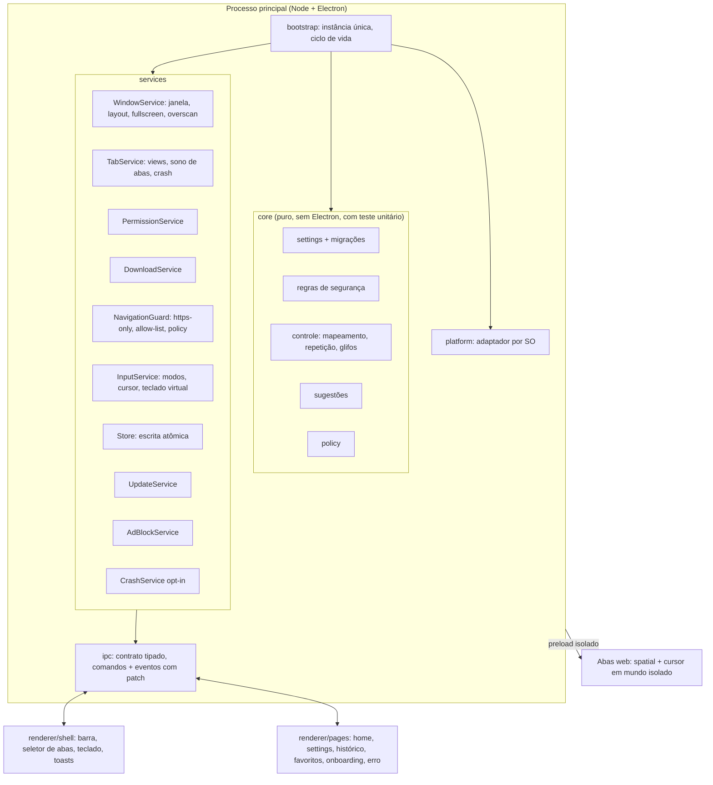
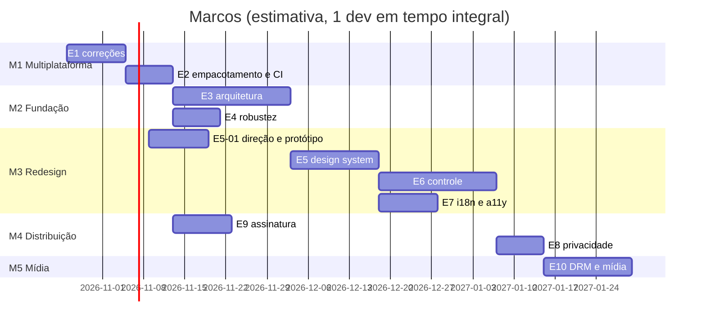

# JoyChromium — PRD 2.0: arquitetura, multiplataforma e redesign

> Documento vivo. Substitui o `docs/CHECKLIST.md` como fonte de verdade do que falta fazer.
> Estado de referência: `main` em a1de202 (Electron 44.8.0 / Chromium 152), outubro de 2026.

## 1. Resumo

O JoyChromium já roda em Electron com um único código para Windows e Linux. O CI verde nas duas plataformas prova isso: typecheck, 20 testes unitários, 3 e2e com o app real e um build de instalador. O que falta para ser um produto multiplataforma de verdade, e um navegador de TV bom de usar, cai em quatro frentes:

1. **Multiplataforma completo.** O macOS não existe (sem target, sem CI, sem assinatura). Também há bugs de borda no Linux e no mac (botões da janela invisíveis, copiar/colar, atalhos e caminhos).
2. **Arquitetura.** O `shell.ts` concentra quase tudo. A UI é HTML/TS sem bundler e sem componentes, os tokens de design estão duplicados em cada página, a persistência não é atômica e há configurações que não fazem nada desde a saída do WebView2.
3. **Redesign 10-foot.** A interface atual é um navegador de desktop com fontes de 10 a 13 px, ícones em caracteres Unicode e emoji, e fontes do Windows. Para TV, a 3 metros de distância, ela precisa de outra escala, outra hierarquia e navegação por foco desenhada para o controle.
4. **Distribuição.** Faltam assinatura e notarização, arm64 e mais formatos de Linux. DRM (Widevine) é uma decisão de produto em aberto.

O Electron continua sendo a base. A seção 5.1 explica por quê.

## 2. Objetivos e não-objetivos

### Objetivos
- **O1.** Mesma experiência em Windows 10/11, macOS (Apple Silicon e Intel) e Linux (X11 e Wayland; Ubuntu/Debian, Fedora, Arch e SteamOS), em x64 e arm64.
- **O2.** Uso completo só com controle, do primeiro boot até assistir a um vídeo, sem teclado nem mouse.
- **O3.** Interface legível a 3 m numa TV 1080p e 4K, com área segura de overscan.
- **O4.** Atualização automática segura nas três plataformas, com builds assinados.
- **O5.** Uma arquitetura em que cada responsabilidade tem um módulo, com contrato de IPC tipado e lógica pura testável sem Electron.

### Não-objetivos (nesta versão)
- Extensões de navegador (Chrome Web Store).
- Sincronização de conta entre dispositivos.
- Builds para Android TV, tvOS ou webOS. Eles exigiriam outro motor e outro produto.
- Motor próprio ou fork do Chromium.

## 3. Personas e cenários

| Persona | Contexto | O que precisa |
|---|---|---|
| **Sofá** | PC ou mini-PC ligado na TV, controle Xbox/PS/8BitDo | Abrir YouTube TV, Twitch e streaming em 3 cliques, digitar pouco, nunca precisar do mouse |
| **HTPC / Steam Deck** | Linux (SteamOS, Ubuntu), muitas vezes Wayland ou modo Gaming | Tela cheia de verdade, controle sem configuração, atualização sem terminal |
| **Mac na TV** | Mac mini ligado à TV por HDMI | Atalhos Cmd, janela nativa, app assinado que abre sem alerta do Gatekeeper |
| **Desktop eventual** | Mesma máquina usada na mesa | Modo janela com mouse e teclado continua funcional |

Cenários de aceite de ponta a ponta (servem de roteiro para os testes manuais com controle):

1. Primeiro boot → onboarding com teste do controle → escolher idioma e buscador → tela inicial.
2. Tela inicial → YouTube TV (modo Arrows) → vídeo em tela cheia → voltar com B.
3. Pesquisar "previsão do tempo" com o teclado virtual e as sugestões, abrir o resultado e navegar no modo Spatial.
4. Abrir três abas, alternar pelo seletor de abas e fechar uma, só com controle.
5. Um site pede o microfone → prompt navegável → "permitir sempre".
6. Atualização baixada em segundo plano → aplicada ao fechar → o app reabre na versão nova.

## 4. Diagnóstico do estado atual

### 4.1 O que já está bom
- Electron 44 com sandbox, `contextIsolation` e preloads isolados. As páginas web não recebem nenhuma API.
- Segurança de navegação: lista de esquemas permitidos, HTTPS-only com fallback por host, erro de certificado sem bypass, popups limitados, permissões negadas por padrão com memória por site, downloads perigosos recusados.
- Bloqueio de anúncios com o motor Ghostery, cacheado em disco e atualizado a cada 24 h.
- Policy remota assinada (ECDSA P-256) que só aperta as regras.
- Pipeline Dependabot → CI → auto-merge → tag → release → `electron-updater`.
- Três modos de entrada (Spatial, Cursor, Arrows) lembrados por host.

### 4.2 Problemas encontrados

| # | Área | Problema | Evidência | Impacto |
|---|---|---|---|---|
| D1 | Plataforma | Botões minimizar/maximizar/fechar usam glifos da fonte `Segoe MDL2 Assets`, que só existe no Windows | `app/src/assets/chrome/chrome.css:33`; no Linux os botões aparecem vazios | Sem como fechar ou minimizar a janela pelo mouse no Linux e no mac |
| D2 | Plataforma | `Menu.setApplicationMenu(null)` remove o menu de edição | `app/src/main/main.ts:40` | No macOS, Cmd+C/V/X/A e Cmd+Q deixam de funcionar |
| D3 | Plataforma | Atalhos do renderer testam só `ctrlKey`, e os textos de ajuda dizem "Ctrl+" | `app/src/renderer/chrome.ts:235`, títulos no HTML | Atalhos errados no mac |
| D4 | Plataforma | Pasta de downloads montada com `homedir()/Downloads` | `app/src/main/shell.ts` (`handleDownload`) | Ignora pastas XDG localizadas no Linux e diverge do export de diagnóstico, que usa `app.getPath("downloads")` |
| D5 | Plataforma | Extensões perigosas sem as do macOS (`.dmg`, `.pkg`, `.app`, `.command`...) | `app/src/shared/security.ts:6` | Instaladores de mac passam |
| D6 | Plataforma | macOS sem target, ícone em alta resolução (o `icon.png` tem 256 px), CI, entitlements ou assinatura | `app/package.json` (`build`) | Não existe build para mac |
| D7 | Plataforma | Só x64 | `app/package.json` | Sem Apple Silicon nativo, sem Raspberry Pi/TV boxes ARM, sem Windows on ARM |
| D8 | Robustez | Sem trava de instância única | `app/src/main/main.ts` | Duas instâncias sobrescrevem `settings.json`, `session.json` e histórico |
| D9 | Robustez | Escritas síncronas de arquivo inteiro, sem gravar em temporário e renomear | `app/src/main/store.ts`, `history.ts` | Queda de energia no meio da escrita corrompe as configurações |
| D10 | Robustez | "Abas dormindo após 10 min" está marcada como feita no checklist, mas não existe no Electron (`lastActive` é gravado e nunca lido) | `app/src/main/tabs.ts` | Memória cresce sem limite em mini-PCs de TV |
| D11 | Produto | Configurações sem efeito: `trackingPrevention`, `passwordAutosave` e `autofill` são salvas, mas nada no main as aplica | `app/src/main/pageBridge.ts:111-112` | O usuário acha que está protegido e não está |
| D12 | Produto | A página de settings ainda fala em "WebView2, atualizado pelo Windows" | `app/src/assets/settings.html:156,198` | Texto falso em Linux e mac |
| D13 | Arquitetura | `shell.ts` (576 linhas) cuida de janela, layout, permissões, downloads, teclado virtual, busca, modos de entrada, atalhos e IPC | `app/src/main/shell.ts` | Difícil de testar e de mexer em paralelo |
| D14 | Arquitetura | Canais de IPC duplicados nos preloads, porque preload sandboxed não importa módulos; o canal `shell:layout` nem está em `ipc.ts` | `app/src/preload/*.ts`, `app/src/main/shell.ts` | Contrato de IPC pode divergir em silêncio |
| D15 | Arquitetura | O estado inteiro é reenviado ao renderer a cada mudança | `Shell.broadcast()` | Custo cresce com o número de abas e repinta a UI toda |
| D16 | Arquitetura | `spatial.js` é injetado com `executeJavaScript` no mundo da página e só no frame principal | `app/src/main/tabs.ts` (`dom-ready`) | A página enxerga e pode quebrar `window.__joy`; iframes (players embutidos) ficam sem navegação espacial |
| D17 | UI | Tokens de cor e fonte copiados em cada HTML; fonte `Segoe UI`; ícones em Unicode e emoji; fonte base de 10 a 13 px | `chrome.css`, `list.css`, `<style>` de cada página | Visual inconsistente entre SOs e ilegível na TV |
| D18 | UI | Strings em inglês fixas no HTML; sem i18n | todas as páginas | Sem PT-BR |
| D19 | Docs | `docs/CHECKLIST.md` descreve WebView2, Velopack, FlaUI e `%LocalAppData%`; o `CLAUDE.md` aponta a chave da policy em `%USERPROFILE%` | `docs/`, `CLAUDE.md` | Passa a impressão de projeto só para Windows |
| D20 | Mídia | Electron padrão não traz Widevine | — | Netflix, Prime Video e Disney+ (atalhos padrão da nova aba) não tocam |
| D21 | Update | Em `.deb`/`.rpm`, o `electron-updater` precisa de `installPendingUpdateIfAvailable()` explícito com prompt de senha (pkexec); o app só usa `autoInstallOnAppQuit` | `app/src/main/updater.ts`; documentação do electron-builder | Usuários de `.deb` podem ficar presos numa versão |

## 5. Arquitetura alvo

### 5.1 Decisão de base: continuar no Electron (ADR-001)

| Opção | Prós | Contras | Veredito |
|---|---|---|---|
| **Electron (atual)** | Chromium igual nos três SOs, atualizado por Dependabot; `WebContentsView`, `session` e `webRequest` para bloqueio; Gamepad API; ecossistema de empacotamento e update | Pacote de ~100 MB, uso de memória | **Manter** |
| Tauri | Binário pequeno | Usa o WebView do SO (WebKit no mac e Linux): perde o Chromium uniforme, o bloqueio por sessão e o comportamento igual do Gamepad API; o UA de TV muda por SO | Descartado |
| CEF (C++) / .NET + CefSharp | Controle total | Meses de trabalho; o CefSharp é só Windows, que é exatamente o problema de que saímos | Descartado |

### 5.2 Visão geral



### 5.3 Estrutura de pastas proposta

```
app/
  electron.vite.config.ts
  src/
    core/            # puro: settings, segurança, policy, controle, sugestões, páginas, i18n (teste unitário)
    main/
      bootstrap.ts   # instância única, ciclo de vida, wiring
      platform/      # index.ts + win32.ts / darwin.ts / linux.ts
      services/      # window, tabs, permissions, downloads, navigation, input, store, update, adblock, crash
      ipc/           # contrato, roteador de comandos e emissor de eventos
    preload/         # shell.ts, pages.ts, web.ts (bundlados: podem importar o contrato de IPC)
    renderer/
      design/        # tokens.css, tipografia, ícones, componentes de foco
      shell/         # UI do navegador
      pages/         # home, settings, history, favorites, onboarding, error
    inject/          # spatial e cursor, compilados para o mundo isolado das abas
  resources/         # ícones por SO, entitlements do mac
```

### 5.4 Decisões técnicas (ADRs a registrar em `docs/adr/`)

- **ADR-002: build com `electron-vite`.** Hoje é `tsc` mais um script que copia arquivos. O `electron-vite` empacota main, preloads e renderer. Isso resolve o D14, porque o preload empacotado pode importar o contrato de IPC, e dá hot reload na UI.
- **ADR-003: framework de UI.** Recomendação: **React 19 + TypeScript** no renderer, com navegação por foco própria baseada no `spatial` atual (ou em `@noriginmedia/norigin-spatial-navigation`, feita para TV). O motivo é que o redesign cria muitas telas com componentes repetidos (cards, listas focáveis, diálogos, teclado), e manter isso em HTML com script inline não escala. A alternativa leve é Preact com a mesma API. **Decisão pendente do dono do produto.**
- **ADR-004: contrato de IPC tipado.** Um módulo `ipc/contract.ts` com os comandos (renderer → main) e os eventos (main → renderer), validados com `zod` na entrada do main. O estado sai como snapshot inicial mais patches por área (`tabs`, `overlay`, `theme`, `status`), e não como o estado inteiro a cada mudança (D15).
- **ADR-005: persistência.** Continua em JSON (`settings.json`, `session.json`, `history.jsonl`), agora com escrita atômica (temporário mais `rename`), debounce, `schemaVersion` e migrações puras em `core/settings`. SQLite fica fora porque exigiria módulo nativo recompilado por SO e por arquitetura.
- **ADR-006: injeção em mundo isolado.** `spatial` e cursor rodam via preload ou `executeJavaScriptInIsolatedWorld`, também nos subframes (via `webFrameMain`). Assim a página não acessa `window.__joy` (D16).
- **ADR-007: adaptador de plataforma.** Toda decisão por SO passa por `platform/`: opções da janela, menu de aplicação, modificador de atalho e rótulo, caminhos, extensões perigosas extras, comportamento ao fechar a última janela e integração de mídia. O resto do código não testa `process.platform`.
- **ADR-008: dois layouts, um núcleo.** O **modo TV** (padrão quando há controle ou tela cheia) e o **modo Janela** (mouse e teclado) usam os mesmos serviços e componentes, mudando escala, densidade e o que aparece.

### 5.5 Matriz de plataforma

| Tema | Windows | macOS | Linux |
|---|---|---|---|
| Janela | sem moldura + controles próprios em SVG | `titleBarStyle: "hiddenInset"` com os botões nativos | sem moldura + controles em SVG; validar arrasto no Wayland |
| Menu de aplicação | nenhum | menu mínimo com papéis `appMenu` e `editMenu` | nenhum |
| Modificador | Ctrl | Cmd | Ctrl |
| Fechar última janela | sai | sai (decisão de produto: é um app de TV) | sai |
| Downloads | `app.getPath("downloads")` | idem | idem (respeita XDG) |
| Extensões perigosas extras | — | `.dmg .pkg .mpkg .app .command .scpt .workflow .terminal` | `.desktop .flatpakref .snap` |
| Formatos | NSIS (x64, arm64) | DMG + ZIP (universal ou x64 + arm64) | AppImage, deb, rpm (x64, arm64); Flatpak depois |
| Auto-update | NSIS por usuário | Squirrel.Mac (exige app assinado) | AppImage automático; deb/rpm com prompt de senha |
| Assinatura | Azure Trusted Signing ou certificado OV/EV | Developer ID + notarização | GPG opcional nos pacotes |
| Mídia do SO | SMTC via Chromium | Now Playing via Chromium | MPRIS via Chromium |
| Permissões do SO | — | `NSCameraUsageDescription`, `NSMicrophoneUsageDescription` | — |
| Riscos | SmartScreen sem assinatura | Gatekeeper bloqueia sem notarização | sandbox do AppImage no Ubuntu 24.04 (user namespaces via AppArmor); Wayland |

## 6. Redesign 10-foot

### 6.1 Princípios
1. **Legível a 3 m.** Texto base de 24 px e mínimo de 20 px numa tela de 1920×1080 (escala com `rem` a partir da resolução e de um ajuste do usuário). Alvos focáveis de pelo menos 64 px de altura.
2. **Um foco sempre visível.** Anel de foco de alto contraste com leve escala, nunca removido; o foco nunca se perde ao abrir ou fechar overlays.
3. **Área segura.** Margem de overscan configurável (padrão de 5%) para TVs que cortam as bordas.
4. **Menos chrome durante o conteúdo.** Em modo TV, a barra some quando a página tem o foco e volta com um botão (Guide/Start ou Y).
5. **O controle mostra o caminho.** Dicas de botão com o glifo do controle conectado (Xbox, PlayStation, Switch, genérico), detectado pelo `id` do Gamepad API.
6. **Igual em todo SO.** Fonte embutida (Inter, licença OFL) e ícones SVG (Lucide, licença ISC), em vez de Segoe e Unicode.

### 6.2 Design system
- **Tokens únicos** em `renderer/design/tokens.css`, servidos para o shell e para todas as páginas internas: cores (os presets Mint, Ocean, Ember, Violet e Light continuam), espaçamento em escala de 4, raios, sombras, durações de animação e escala tipográfica (display, título, corpo, legenda).
- **Componentes:** `FocusRing`, `Button`, `IconButton`, `Card`/`Tile`, `List`/`ListItem`, `Dialog`, `Toast`, `Toggle`, `Select` navegável, `Tabs` laterais, `Keyboard`, `ButtonHint` (glifo + texto).
- **Acessibilidade:** contraste AA mínimo (AAA no texto principal do modo TV), alto contraste, escala de texto de 80% a 150%, `prefers-reduced-motion`, `aria-*` em tudo que é focável.

### 6.3 Telas e fluxos

| Tela | Hoje | Proposta |
|---|---|---|
| **Barra (modo TV)** | Barra de título com abas pequenas + toolbar de desktop + status bar | Barra única e alta: voltar, campo de endereço grande, favorito, abas (contador) e menu; esconde-se automaticamente sobre o conteúdo |
| **Barra (modo Janela)** | igual | Layout compacto parecido com o atual, já com tokens e ícones novos e controles de janela por SO |
| **Seletor de abas** | Abas de 220 px na barra de título, LT/RT | Overlay em grade com miniaturas (`webContents.capturePage`), aberto por um botão; LT/RT continuam para alternar rápido |
| **Tela inicial** (nova aba) | Busca + tiles de atalhos | Hub: busca em destaque, linha de "Continuar" (sessão e recentes), favoritos, apps de TV (YouTube TV, Twitch...) em cards grandes |
| **Menu rápido** | — | Overlay no botão Guide/Start: recarregar, zoom, modo de entrada, tela cheia, silenciar, configurações |
| **Teclado virtual** | Grade de 10 colunas fixa em inglês | QWERTY e ABC, layout PT-BR com acentos (segurar A para variantes), linha de `.com`, `www.`, `https://`, sugestões navegáveis acima das teclas, cursor e apagar palavra |
| **Status** | Texto em caixa-alta no rodapé | Toasts curtos com ícone; a status bar só aparece no modo Janela |
| **Prompt de permissão** | Painel no topo | Diálogo centralizado, com o foco já no "Negar" e uma explicação de uma linha |
| **Configurações** | Página longa de 378 linhas | Navegação lateral por seções (Geral, Aparência, Controle, Privacidade e segurança, Downloads, Sobre e atualizações), uma decisão por linha |
| **Onboarding** | Lista do que vem ligado | Idioma → teste do controle (mostra os botões detectados) → buscador → tema → overscan → pronto |
| **Erro** | Página simples | Mesmo visual, com ações grandes (tentar de novo, voltar, abrir em HTTP quando aplicável) |

### 6.4 Entregáveis de design
1. Moodboard e direção visual (duas opções) para aprovação.
2. Protótipo navegável das telas da seção 6.3 nos dois modos, em 1920×1080 e 1280×720.
3. Biblioteca de componentes e tokens, implementada em `renderer/design` com uma página interna de catálogo (`joychromium://design`) só no build de desenvolvimento.
4. Teste com controle físico na TV antes de fechar cada tela.

## 7. Requisitos não funcionais

| Requisito | Meta |
|---|---|
| Boot até a tela inicial | < 2 s em SSD (medido pelo log de início) |
| Latência do controle | < 50 ms do botão até o foco mudar (o polling atual é de 50 ms) |
| Memória | Abas inativas há mais de 10 min dormem (exceto com áudio); teto configurável de abas acordadas |
| Robustez | Nenhuma corrupção de configurações num kill -9 durante a escrita (teste automatizado) |
| Segurança | Sandbox, `contextIsolation` e CSP estrita em todas as páginas internas; fuses do Electron (`runAsNode` desligado, `onlyLoadAppFromAsar` ligado, integridade do asar) |
| Privacidade | Telemetria e envio de crashes desligados por padrão, com opt-in no onboarding |
| Qualidade | typecheck, unitários e e2e verdes em Windows, macOS e Linux em todo PR |

## 8. Integrações necessárias

| Integração | Para quê | O que precisa | Quem provê | Épico |
|---|---|---|---|---|
| **GitHub Actions** (`windows-latest`, `macos-latest`, `ubuntu-latest`, runners ARM) | CI e release nos três SOs e em arm64 | Atualizar a matriz e os checks obrigatórios da `main` | GitHub (já existe) | E2 |
| **GitHub Releases + `electron-updater`** | Distribuição e auto-update | Já configurado; adicionar artefatos de mac e arm64 | GitHub (já existe) | E2, E9 |
| **Dependabot** | Electron e dependências atualizados | Ajustar se o motor virar castLabs ECS | GitHub (já existe) | E10 |
| **Apple Developer Program** | Certificado Developer ID e notarização | Conta (US$ 99/ano); secrets `CSC_LINK`, `CSC_KEY_PASSWORD`, `APPLE_API_KEY`, `APPLE_API_KEY_ID`, `APPLE_API_ISSUER` | Dono do projeto | E9 |
| **Assinatura no Windows** (Azure Trusted Signing ou certificado OV/EV) | Evitar o alerta do SmartScreen | Conta Azure e perfil de assinatura; secrets `AZURE_TENANT_ID`, `AZURE_CLIENT_ID`, `AZURE_CLIENT_SECRET` | Dono do projeto | E9 |
| **GPG** | Assinar `.deb`/`.rpm` e ativar `allowUnverifiedLinuxPackages = false` | Par de chaves e secret no CI | Dono do projeto | E9 |
| **Flathub / Snap Store** (opcional) | Alcance em distros e SteamOS | Contas e manifesto | Dono do projeto | E9 |
| **castLabs ECS + EVS** (se o DRM for aprovado) | Widevine para streaming pago | Conta gratuita no EVS; cliente `castlabs-evs` (Python) no CI; no mac a assinatura VMP vem **antes** do code signing, no Windows **depois** | castLabs | E10 |
| **Ghostery adblocker** | Listas de bloqueio | Já integrado (CDN da Ghostery) | — | — |
| **Sentry (`@sentry/electron`)** ou endpoint próprio do `crashReporter` | Crashes e erros, opt-in | Projeto e DSN, fora do repositório | Dono do projeto | E8 |
| **Sugestões de busca** (Google/DuckDuckGo suggest) | Sugestões no teclado virtual | Endpoint público; desligado por padrão em abas privadas | — | E6 |
| **Fontes e ícones** (Inter OFL, Lucide ISC) | Visual igual nos SOs | Licenças compatíveis com MIT; embutir no app | — | E5 |
| **HDMI-CEC** (`libcec`, futuro) | Controle remoto da TV no Linux (Raspberry Pi, mini-PCs) | Módulo nativo ou ponte via `cec-client` | — | Futuro |

## 9. Backlog

Prioridade: **P0** bloqueia o marco, **P1** importante, **P2** desejável. Tamanho: **P** (até 1 dia), **M** (2 a 4 dias), **G** (1 a 2 semanas).

### E1 — Correções multiplataforma (Marco M1)

| ID | História | Prioridade | Tamanho | Critérios de aceite |
|---|---|---|---|---|
| E1-01 | Criar `main/platform/` com o adaptador por SO (ADR-007) e mover para ele as decisões que hoje estão espalhadas | P0 | M | Nenhum `process.platform` fora de `platform/`; parte pura (rótulos de atalho, extensões) com teste unitário |
| E1-02 | Controles de janela por SO: SVG no Windows e no Linux, `hiddenInset` com os botões nativos no macOS | P0 | M | Botões visíveis e funcionando nos três SOs; e2e verifica os botões no Windows e no Linux (D1) |
| E1-03 | Menu de aplicação mínimo no macOS (`appMenu`, `editMenu`) | P0 | P | Cmd+C/V/X/A e Cmd+Q funcionam na barra de endereço e nas páginas (D2) |
| E1-04 | Atalhos com modificador por plataforma, e rótulos gerados a partir do adaptador | P0 | P | Cmd no mac e Ctrl nos outros; nenhum "Ctrl+" fixo no HTML (D3) |
| E1-05 | Downloads em `app.getPath("downloads")/JoyChromium` e texto da tela sem barra invertida | P0 | P | Download e diagnóstico caem na mesma pasta em todos os SOs (D4) |
| E1-06 | Extensões perigosas por plataforma | P0 | P | Testes unitários para `.dmg`, `.pkg`, `.app`, `.desktop` (D5) |
| E1-07 | Instância única: `requestSingleInstanceLock`; uma segunda execução foca a janela existente e abre a URL recebida | P0 | P | e2e: segunda instância não abre outra janela (D8) |
| E1-08 | Remover as referências ao WebView2 da tela de configurações; mostrar a versão do Chromium e do Electron | P0 | P | Nenhuma menção a WebView2 no app (D12) |
| E1-09 | Configurações sem efeito: implementar ou remover `trackingPrevention`, `passwordAutosave` e `autofill` | P0 | M | Cada opção visível tem efeito verificável, ou some da tela e do schema com migração (D11) |

### E2 — Empacotamento e CI multiplataforma (Marco M1)

| ID | História | Prioridade | Tamanho | Critérios de aceite |
|---|---|---|---|---|
| E2-01 | Target macOS: DMG + ZIP, ícone a partir de um PNG de 1024 px, `hardenedRuntime`, entitlements, `NSCameraUsageDescription`/`NSMicrophoneUsageDescription` | P0 | M | `npm run dist` gera DMG e ZIP no mac; câmera funciona depois de permitida |
| E2-02 | `macos-latest` no `ci.yml` (typecheck, unitários, e2e, empacotamento) e no `release.yml` | P0 | P | Job verde; artefatos publicados na release |
| E2-03 | Atualizar a proteção da `main` com `electron (macos-latest)`; atualizar `CONTRIBUTING.md`, `CLAUDE.md` e o comentário do `auto-merge.yml` | P0 | P | Auto-merge só depois dos três checks |
| E2-04 | Builds arm64: mac (universal ou separados), Linux arm64, Windows arm64 | P1 | M | Artefatos arm64 na release; `latest*.yml` corretos para o updater |
| E2-05 | Linux: target `rpm`; testar AppImage no Ubuntu 24.04 (sandbox) e documentar a saída escolhida | P1 | M | Instala e abre no Ubuntu 24.04 e no Fedora atual sem `--no-sandbox` |
| E2-06 | Update em deb/rpm: chamar `installPendingUpdateIfAvailable()` num momento controlado, com aviso na UI | P1 | P | Atualização aplicada num `.deb` instalado (D21) |
| E2-07 | Smoke test do pacote instalado (instala, abre, fecha) nos três SOs no CI | P2 | M | Job de smoke após o empacotamento |
| E2-08 | Validação em Wayland (GNOME e KDE) e no modo Gaming do SteamOS | P1 | M | Roteiro manual da seção 3 passa; problemas viram issues |

### E3 — Fundação de arquitetura (Marco M2)

| ID | História | Prioridade | Tamanho | Critérios de aceite |
|---|---|---|---|---|
| E3-01 | Migrar o build para `electron-vite` (ADR-002) mantendo o comportamento | P0 | M | `npm start`, `dist` e e2e iguais; hot reload no renderer |
| E3-02 | Contrato de IPC tipado com validação (ADR-004); preloads importam o contrato | P0 | M | Nenhum nome de canal duplicado; mensagem inválida é rejeitada e logada (D14) |
| E3-03 | Estado por patches em vez de snapshot completo | P1 | M | Com 30 abas, o tráfego de IPC cai para menos de 10% do atual (D15) |
| E3-04 | Quebrar o `shell.ts` nos serviços da seção 5.2 | P0 | G | Nenhum arquivo do main com mais de 250 linhas; cada serviço com testes (D13) |
| E3-05 | Store com escrita atômica, debounce, `schemaVersion` e migrações (ADR-005) | P0 | M | Teste de kill durante a escrita não corrompe; migração v1 → v2 com teste (D9) |
| E3-06 | `spatial` e cursor em mundo isolado e nos subframes (ADR-006) | P1 | M | A página não vê `window.__joy`; navegação espacial funciona num player em iframe (D16) |
| E3-07 | Fuses do Electron e revisão de segurança (CSP de todas as páginas internas, `will-attach-webview`, `webSecurity`) | P1 | P | `@electron/fuses` aplicado no build; checklist de segurança do Electron revisado |
| E3-08 | Adotar o framework de UI decidido no ADR-003, com o shell como primeira tela migrada | P0 | G | Shell em componentes; e2e atual passa sem mudança de comportamento |

### E4 — Robustez e desempenho (Marco M2)

| ID | História | Prioridade | Tamanho | Critérios de aceite |
|---|---|---|---|---|
| E4-01 | Abas dormindo depois de 10 min sem uso (exceto com áudio), restauradas ao ativar | P0 | M | e2e com relógio acelerado; memória cai depois de dormir (D10) |
| E4-02 | Recuperação de sessão depois de crash do processo principal (marcador de "fechamento limpo") | P1 | P | Depois de um kill, oferece restaurar as abas |
| E4-03 | Pausar o polling do controle com a janela minimizada ou sem foco | P2 | P | CPU ociosa perto de zero com a janela minimizada |
| E4-04 | Métricas locais de boot e de memória no diagnóstico | P2 | P | Valores aparecem no zip de diagnóstico |

### E5 — Design system e redesign (Marco M3)

| ID | História | Prioridade | Tamanho | Critérios de aceite |
|---|---|---|---|---|
| E5-01 | Direção visual e protótipo navegável (seção 6.4) | P0 | G | Aprovado pelo dono do produto |
| E5-02 | Tokens, fonte Inter e ícones Lucide em `renderer/design`, servidos a todas as páginas | P0 | M | Nenhum `:root` duplicado; nenhuma fonte Segoe; nenhum ícone em Unicode/emoji (D17) |
| E5-03 | Componentes focáveis e catálogo `joychromium://design` (só em dev) | P0 | G | Todos os componentes da seção 6.2 navegáveis por controle |
| E5-04 | Modo TV e modo Janela (ADR-008), com troca automática e manual | P0 | G | Ao conectar o controle ou entrar em tela cheia, sugere o modo TV |
| E5-05 | Escala de UI, overscan e alto contraste nas configurações | P1 | M | Ajuste ao vivo, persistido |
| E5-06 | Glifos por tipo de controle (Xbox, PlayStation, Switch, genérico) | P1 | M | Dicas mudam ao trocar de controle |
| E5-07 | Toasts no lugar da status bar no modo TV | P1 | P | Mensagens somem sozinhas e são anunciadas ao leitor de tela |

### E6 — Experiência com controle (Marco M3)

| ID | História | Prioridade | Tamanho | Critérios de aceite |
|---|---|---|---|---|
| E6-01 | Barra do modo TV que se esconde sobre o conteúdo | P0 | M | Cenário 2 da seção 3 passa só com controle |
| E6-02 | Seletor de abas em grade com miniaturas | P0 | M | Cenário 4 passa só com controle |
| E6-03 | Tela inicial nova (busca, "Continuar", favoritos, apps de TV) | P0 | M | Cenário 1 termina nela; tudo alcançável pelo D-pad |
| E6-04 | Menu rápido no Guide/Start | P1 | M | Zoom, modo de entrada, tela cheia e silenciar acessíveis só pelo controle |
| E6-05 | Teclado virtual novo: layouts, acentos PT-BR, atalhos de URL, sugestões navegáveis | P0 | G | Cenário 3 passa; digitar "ação" sem teclado físico |
| E6-06 | Onboarding novo com teste do controle | P1 | M | Mostra os botões detectados e confirma o mapeamento |
| E6-07 | Sessão de teste com controle físico em YouTube TV, Wikipedia e um streaming; ajustar a pontuação do `spatial` e a velocidade do cursor | P0 | M | Relatório com problemas e ajustes aplicados |
| E6-08 | Vários controles conectados: o último usado assume | P2 | P | Troca de controle sem reiniciar |
| E6-09 | Vibração (`vibrationActuator`) para confirmação e erro, com opção de desligar | P2 | P | Funciona em Xbox e DualSense onde o SO suporta |

### E7 — Internacionalização e acessibilidade (Marco M3)

| ID | História | Prioridade | Tamanho | Critérios de aceite |
|---|---|---|---|---|
| E7-01 | i18n com dicionários em `core/i18n` (PT-BR e EN), idioma do SO como padrão | P0 | M | Nenhuma string de UI fixa; troca de idioma ao vivo (D18) |
| E7-02 | `lang`, `aria-*` e ordem de foco em todas as telas | P1 | M | Auditoria com axe sem violações sérias |
| E7-03 | Teste com leitor de tela (Narrator, VoiceOver, Orca) nas telas principais | P2 | M | Fluxo de busca utilizável com leitor de tela |

### E8 — Privacidade, segurança e observabilidade (Marco M4)

| ID | História | Prioridade | Tamanho | Critérios de aceite |
|---|---|---|---|---|
| E8-01 | Envio de crashes e erros opt-in (Sentry ou `crashReporter` próprio), sem URLs nem dados pessoais | P1 | M | Desligado por padrão; liga no onboarding ou nas configurações |
| E8-02 | "Limpar dados" completo: histórico, cache, cookies, permissões, por período | P1 | P | Cada item é limpo de verdade (teste) |
| E8-03 | Proteção contra rastreamento real (se mantida no E1-09): listas de rastreadores do Ghostery por nível | P2 | M | Cada nível muda o que é bloqueado |
| E8-04 | Documentar o local da chave de assinatura da policy para os três SOs (`~/.joychromium/`) e o procedimento de backup | P1 | P | `CLAUDE.md` sem caminhos só de Windows |

### E9 — Distribuição assinada (Marco M4, depende de contas externas)

| ID | História | Prioridade | Tamanho | Critérios de aceite |
|---|---|---|---|---|
| E9-01 | Assinatura e notarização no macOS no `release.yml` | P0 | M | App abre sem alerta do Gatekeeper; auto-update do mac funciona |
| E9-02 | Assinatura no Windows (Azure Trusted Signing ou certificado) | P0 | M | Instalador assinado |
| E9-03 | Assinatura GPG de deb/rpm e `allowUnverifiedLinuxPackages = false` | P2 | P | Updater recusa pacote sem assinatura |
| E9-04 | Changelog gerado a partir dos Conventional Commits na release | P2 | P | Notas da release preenchidas automaticamente |
| E9-05 | Flatpak (Flathub) | P2 | G | Publicado e atualizando pelo Flathub |

### E10 — Mídia e DRM (Marco M5, depende de decisão)

| ID | História | Prioridade | Tamanho | Critérios de aceite |
|---|---|---|---|---|
| E10-01 | **Decisão:** adotar o castLabs ECS para Widevine ou tirar os atalhos de serviços com DRM | P0 | P | Decisão registrada em ADR |
| E10-02 | Se aprovado: trocar `electron` por castLabs ECS, ajustar Dependabot e o gatilho de release, e adicionar a assinatura VMP (EVS) nos hooks do electron-builder | P0 | G | Netflix e Prime Video tocam em Windows e mac; no Linux, onde a CDM permitir |
| E10-03 | Teclas de mídia e `navigator.mediaSession` integradas ao controle (play/pause no A durante o vídeo) | P1 | M | Play/pause e próxima faixa pelo controle e pelas teclas de mídia |
| E10-04 | Picture-in-picture | P2 | M | PiP abre e fecha pelo menu rápido |

### E11 — Documentação (contínuo)

| ID | História | Prioridade | Tamanho | Critérios de aceite |
|---|---|---|---|---|
| E11-01 | Aposentar o `docs/CHECKLIST.md` (movê-lo para `docs/history/`) e apontar o README para este PRD | P0 | P | Nenhuma doc atual fala de WebView2, Velopack ou FlaUI (D19) |
| E11-02 | README com Windows, macOS e Linux; requisitos e formatos por SO | P0 | P | Instruções verificadas nos três SOs |
| E11-03 | `docs/adr/` com os ADRs 001 a 008 | P1 | P | Um arquivo por decisão |

## 10. Roadmap



- **M1, Multiplataforma (v1.1):** E1 + E2 + E11-01/02. Sai uma build de macOS não assinada para teste, e o Linux sem bugs de janela.
- **M2, Fundação (v1.2):** E3 + E4. Mesma UI, arquitetura nova; o comportamento coberto pelo e2e não muda.
- **M3, Redesign (v2.0):** E5 + E6 + E7. O protótipo (E5-01) começa em paralelo ao M1 para não travar o M3.
- **M4, Distribuição assinada (v2.1):** E8 + E9. O E9 pode entrar antes, assim que as contas existirem.
- **M5, Mídia (v2.2):** E10, se o DRM for aprovado.

## 11. Métricas de sucesso

| Métrica | Meta |
|---|---|
| Cenários da seção 3 concluídos só com controle | 6 de 6 nos três SOs |
| CI verde nos três SOs | 100% dos PRs mesclados |
| Tempo até o foco mudar após o D-pad | < 50 ms (p95) |
| Boot até a tela inicial | < 2 s |
| Usuários na versão mais nova 7 dias após a release | > 80% (estimado pelos downloads dos artefatos de update) |
| Crashes por sessão (com opt-in) | < 0,5% |

## 12. Riscos

| Risco | Probabilidade | Impacto | Mitigação |
|---|---|---|---|
| Sem conta Apple, o mac fica preso em build de teste (Gatekeeper, sem auto-update) | Alta | Alto | Distribuir o mac como "beta" até o E9-01; documentar como abrir |
| Sandbox do AppImage no Ubuntu 24.04 | Média | Médio | Priorizar o `.deb`; testar o perfil AppArmor; Flatpak como alternativa |
| Wayland: arrasto da janela, tela cheia e foco | Média | Médio | E2-08 com roteiro manual; fallback documentado para X11 |
| O Gamepad API pode não entregar dados ao shell enquanto a aba web tem o foco | Média | Alto | Validar no E6-07 com controle físico; se confirmado, mover o polling para um ponto que sempre tenha foco ou usar uma ponte nativa |
| castLabs ECS atrasa em relação ao Electron oficial | Média | Médio | Monitorar a defasagem; a policy remota já define um Chromium mínimo |
| Redesign e troca de framework juntos aumentam o risco de regressão | Média | Alto | M2 primeiro, sem mudar a UI; e2e como rede de segurança; migrar tela por tela |
| Mudanças grandes no `shell.ts` em paralelo geram conflitos | Alta | Médio | E3-04 antes de qualquer feature nova no shell |

## 13. Decisões em aberto

1. **Framework de UI (ADR-003):** React (recomendado) ou Preact.
2. **DRM (E10-01):** adotar castLabs ECS ou remover Netflix, Prime Video e Disney+ dos atalhos padrão.
3. **Orçamento de assinatura:** Apple Developer (US$ 99/ano) e assinatura no Windows (Azure Trusted Signing é a opção mais barata).
4. **Versões mínimas de SO:** seguir as mínimas do Electron 44 ou fixar algo mais novo.
5. **Telemetria:** Sentry hospedado ou endpoint próprio do `crashReporter`.
6. **Modo padrão:** abrir já em modo TV (tela cheia) ou em janela até detectar controle.
